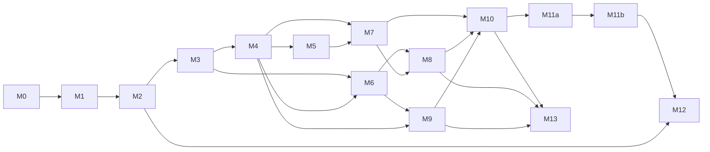

# Abstract Economic Simulation Framework
## Implementation Roadmap

**Version:** 1.0  
**Status:** Planning baseline (draft)  
**Companions:** 01–07

---

## 1. Purpose and Use

This roadmap orders the implementation of the framework (01–05) and the reference implementation (07) so that **risks are retired early and spread evenly**, and so that a working, tested, and, from M2, playable system exists at the end of every milestone.

It is the input for **OpenSpec change specs**:

- Each row in a milestone's change table is one OpenSpec change. Its **Change ID** is the OpenSpec change name.
- The **Capability** column is the OpenSpec spec path (`openspec/specs/<capability>/spec.md`), following the taxonomy in Section 6.
- **Sources** are requirement IDs (06 §3.1). They tell the proposal author which sections are normative for the change.
- **Depends on** lists changes that must be archived before this one is applied. Changes without a mutual dependency may run in parallel (Section 8).
- **Size:** S ≈ up to 1 day, M ≈ 1–3 days, L ≈ 3–5 days of implementation including tests. Anything larger must be split before proposing.

Section 7 is the drafting guide for turning a row into a change.

---

## 2. Strategy

1. **Walking skeleton first.** The full tick pipeline with all 33 phases, hashing, save/load, and the determinism harness exists before any game mechanic (M0). Every later change fills in phases of a structure that is already tested.
2. **Riskiest first.** Determinism in JavaScript, package boundaries, and phase semantics are the most expensive to fix late. They come first.
3. **Vertical slices along the minimal configurations.** The order follows 01 §23: basic loop (23.1) → logistics (23.2) → progression (23.3) → complete game (23.4/23.5). Each slice goes from content schema to kernel to projection to client.
4. **Playable early.** A thin browser client exists from M2 and grows with every milestone. Design risks (legibility, the planning currency, the fun of the loop) are tested by playing, not by reading specs.
5. **Boundaries from day one.** Purity, theme-freedom, and the framework/reference separation are enforced by tooling before the first line of simulation code (M0).
6. **Every milestone ends green and demonstrable.** Exit criteria are tests (scenarios from 06 §9.3) plus a demo.
7. **Spec reconciliation per milestone.** Each milestone ends with OpenSpec verification and an update of 01–07 for any clarified or amended behavior (05 §26).

---

## 3. Risk Register

| ID | Risk | Likelihood | Impact | Mitigation (where retired) |
| --- | --- | --- | --- | --- |
| R-01 | Determinism breaks in JavaScript (floating point, iteration order, engine differences) | High | High | M0: `fx`, canonical encoding, hashing, RNG, browser/Node matrix (0.3, 0.4, 0.9); continuous L7 |
| R-02 | Framework/reference boundary erodes; game terminology leaks into the framework | Medium | High | M0: dependency-cruiser, theme-free lint (0.2) |
| R-03 | Tick-phase semantics are ambiguous; phase interaction bugs surface late | High | High | M0 pipeline skeleton (0.6); M1 slice through phases 05–26; TDS-11.3 clarifications |
| R-04 | Core economic semantics (reservations, all-or-nothing, need windows) implemented wrongly | Medium | High | M1 with invariants INV-01…08, 15, 22 |
| R-05 | The content pipeline (03 is large) stalls progress | Medium | Medium | M1 schemas only for features in scope; each later change adds its own schemas |
| R-06 | TypeScript simulation too slow for browser play | Medium | High | Bench harness in M1 (1.16), browser host in M2, budgets per milestone, optimization in M12 |
| R-07 | Presentation contract unworkable in practice (projection size, deltas, worker messaging) | Medium | High | M2 thin client end to end |
| R-08 | The game is not legible or fun; design ideas do not emerge | Medium | High | Playable client from M2, planning view in M4, progression in M7; balance runner, game HUD client, and human playtest gate in M11a |
| R-09 | Spatial and placement complexity (grid, working areas, coverage, connectivity) | Medium | Medium | M3 dedicated milestone |
| R-10 | Save compatibility breaks repeatedly during development | High | Medium | Versioned save format in M2; golden policy (06 §9.4); migrations in M12 |
| R-11 | Fog leaks undiscovered information | Medium | Medium | M8 fog-filtered projections with property tests (INV-19, P-09) |
| R-12 | Exchanges become a money exploit | Low | Medium | M9 elasticity invariants; M10 arbitrage diagnostics |
| R-13 | Transport complexity (orders, quantity rules, failure policies) | High | Medium | M6 split into small changes |
| R-14 | Specification gaps found late cause rework | High | Medium | Amendment process (05 §26); spec reconciliation at every milestone |
| R-15 | Scope creep (modules, tooling, polish) | Medium | Medium | Optional modules last (M13); non-goals in 07 §17 |
| R-16 | Agent-driven implementation drifts from the specification | Medium | High | AGENTS.md, requirement IDs in specs and tests, trace gate (06 §3.3), `/opsx-verify` before archive |

---

## 4. Milestone Overview

| Milestone | Theme | Retires | Exit scenario(s) | Release |
| --- | --- | --- | --- | --- |
| M0 | Foundation and walking skeleton | R-01, R-02, R-03 (structure), R-16 | Empty world determinism matrix | v0.1 Skeleton |
| M1 | Basic economic loop (headless) | R-03, R-04, R-05, R-06 (baseline) | SCN-01 | — |
| M2 | Session, projections, thin browser client | R-07, R-06 (browser), R-08 (first look), R-10 (format) | SCN-13 basic, client smoke | v0.2 Loop |
| M3 | Space and construction | R-09 | Placement scenario, INV-20 | — |
| M4 | Continuous economy and planning metrics | R-08 (planning currency) | SCN-04, SCN-18 (framework) | v0.3 Builder |
| M5 | Internal-logistics throughput | — | SCN-10 | — |
| M6 | Inter-location logistics | R-13 | SCN-02 | v0.4 Archipelago |
| M7 | Progression | R-08 (pyramid, breadth/depth) | SCN-03, 07, 08, 09, 11, 12 | v0.5 Ascent |
| M8 | Regions, exploration, establishment | R-11 | SCN-05 | — |
| M9 | Exchanges | R-12 | SCN-06 | v0.6 Trade |
| M10 | Validation and diagnostics completeness | R-14 (content side) | Diagnostic fixture suite | — |
| M11a | Reference prototype game | R-08 (balance) | SCN-14, SCN-18 (reference) | v0.9 Prototype |
| M11b | Reference full game | — | SCN-14 on R4 content | — |
| M12 | Persistence hardening, tooling, performance | R-06 (final), R-10 | SCN-13 full, bench budgets | v1.0 |
| M13 | Optional modules | R-15 (contained) | SCN-15, 16, 17 | v1.1 |

### 4.1 Milestone dependencies



M5 and M6 may overlap. M8 and M9 may overlap. M12 changes that depend only on M2 (migrations, replay documents) may start early.

---

## 5. Milestones

### M0 — Foundation and Walking Skeleton

**Goal:** A monorepo with enforced boundaries and an empty but complete, deterministic, hashable, savable tick pipeline that produces the same hashes in Node and in the browser.

| # | Change ID | Capability | Scope | Sources | Depends on | Size |
| --- | --- | --- | --- | --- | --- | --- |
| 0.1 | `setup-workspace` | foundation/workspace | pnpm workspace; all package stubs of TDS-4.2; tsconfig project references; Vitest, ESLint, Prettier; CI skeleton ✓ archived 2026-10-21 | TDS-2, TDS-4.1, TDS-4.2, TDS-25, VER-15.3 | — | M |
| 0.2 | `add-purity-and-boundary-guardrails` | foundation/purity | dependency-cruiser rules; restricted globals, properties, and syntax; theme-free lint; ambient-API traps; registry deep-freeze helper ✓ archived 2026-10-21 | TDS-4.3, TDS-5 | 0.1 | S |
| 0.3 | `add-fixed-point-arithmetic` | foundation/fixed-point | `fx` module, rounding modes, `alloc-v1`, rate accumulators; properties P-01 to P-03 ✓ archived 2026-10-21 | TDS-6 | 0.2 | M |
| 0.4 | `add-deterministic-primitives` | foundation/determinism | canonical JSON, FNV-1a 64, xoshiro128\*\* streams, stable sort, string comparison, branded IDs, `Result`; properties P-04, P-05 ✓ archived 2026-10-21 | TDS-7, TDS-9.4, TDS-15, TDS-19.3, TDS-19.4, TDS-23 | 0.2 | M |
| 0.5 | `add-world-state-model` | kernel/world-state | `World` record, entity allocator, `ComponentStore` with sorted iteration and tombstones, owners table, encode/decode/clone/hash ✓ archived 2026-10-21 | TDS-8, ARCH-3, ARCH-4.2 | 0.3, 0.4 | M |
| 0.6 | `add-tick-pipeline-skeleton` | kernel/tick-pipeline | phase table 01–33 as registered no-ops, `SystemDescriptor`, `TickContext`, `EventWriter`, `step`, `runPhases`, write-set checks in test builds ✓ archived 2026-10-21 | TDS-10, TDS-11, ARCH-5 | 0.5 | M |
| 0.7 | `add-testkit-foundation` | testkit/harness | store-level world builder; `checkInvariants` framework with INV-10, 17, 18, 21, 24; double-run, clone-run, and save-continue harnesses ✓ archived 2026-10-21 | VER-5.2, VER-6, VER-8.1 | 0.6 | M |
| 0.8 | `add-traceability-tool` | testkit/traceability | `pnpm trace`, `exempt.yaml`, generated `docs/traceability.md` ✓ archived 2026-10-21 | VER-3 | 0.1 | S |
| 0.9 | `add-browser-determinism-check` | testkit/determinism-matrix | empty-world replay in Vitest browser mode (Chromium) compared with Node ✓ archived 2026-10-21 | VER-8.2 | 0.7 | S |

**Exit criteria:** an empty world steps 10,000 ticks with stable hashes; hashes are equal in Node and Chromium; a deliberately forbidden import or `Math.random` call fails CI; the trace report is generated.

---

### M1 — Basic Economic Loop (headless)

**Goal:** The closed loop of 01 §23.1 and the 03 §14 example runs headlessly from YAML content, with invariants after every tick and a golden hash.

| # | Change ID | Capability | Scope | Sources | Depends on | Size |
| --- | --- | --- | --- | --- | --- | --- |
| 1.1 | `add-content-package-loader` | content/package-loading | `PackageSource`, manifests, dependency versions, strict YAML parsing, diagnostics model ✓ archived 2026-10-21 | CONT-2, CONT-3, CONT-12, TDS-20.1, TDS-20.3 | 0.4 | M |
| 1.2 | `add-core-definition-schemas` | content/schemas | TypeBox schemas for resource (incl. capability), abstract location template, recipe, entity components (source, producer, residence, storage access), population tier, need (resource consumption and availability), need category, growth policy; ID rules; JSON Schema export ✓ archived 2026-10-21 | CONT-4, CONT-6.1, CONT-6.2, CONT-6.4, CONT-6.7–6.11, CONT-6.13, CONT-6.14, TDS-20.4 | 1.1 | L |
| 1.3 | `add-definition-composition` | content/composition | includes, merge operations, cycle detection; property P-11 ✓ archived 2026-10-21 | CONT-5 | 1.2 | S |
| 1.4 | `add-registry-compilation` | content/registry | reference resolution, handle assignment, indexes, normalization, checksum, frozen `Registry`; property P-12 ✓ archived 2026-10-21 | CONT-11.3, CONT-12, TDS-7, TDS-20.2 | 1.3, 0.5 | M |
| 1.5 | `add-testkit-content-builders` | testkit/harness | fluent `content()` builder through the real pipeline; query and assertion helpers ✓ archived 2026-10-21 | VER-5.2 | 1.4, 0.7 | S |
| 1.6 | `add-condition-and-curve-compiler` | content/conditions | expression tree, type checking, evaluator, curves, initial domain queries (without `sustained`) ✓ archived 2026-10-21 | CONT-7.1–7.3, CONT-8, TDS-14.1, TDS-14.2, TDS-14.4 | 1.4 | M |
| 1.7 | `add-inventory-transactions` | kernel/transactions | inventories, capacity rules, reservation ledger, purposes, transaction union, atomic builder, journal; INV-01 to 04, 15 ✓ archived 2026-10-21 | GDD-8.1–8.4, ARCH-6, ARCH-12, TDS-12 | 0.6 | L |
| 1.8 | `add-abstract-capacity-locations` | sim/spatial | `SpatialPolicy` interface, `abstract_capacity` policy, location entities, `shared_location` access policy, default world instantiation ✓ archived 2026-10-21 | GDD-6.1, ARCH-11, ARCH-12, CONT-6.4, CONT-6.6 | 1.4, 1.7 | M |
| 1.9 | `add-capability-allocation` | sim/capabilities | phases 05–06; recomputed pools; binary, proportional, priority, and weighted models; exact matching and substitutes; INV-05 ✓ archived 2026-10-21 | GDD-4.7, GDD-14, ARCH-13, TDS-6.3 | 1.8 | M |
| 1.10 | `add-production-processes` | sim/production | infinite and finite sources; producer state machine; batch and continuous modes; block reasons; phases 07, 11–13; INV-15, INV-22 ✓ archived 2026-10-21 | GDD-4.3, GDD-9.4, GDD-9.5, GDD-10.1–10.4, ARCH-5.2 | 1.9 | L |
| 1.11 | `add-residences-and-population-outputs` | sim/population | residences, population groups, capability outputs with accumulators (phase 26, outputs only) ✓ archived 2026-10-21 | GDD-11.1–11.3, TDS-6.4 | 1.9 | M |
| 1.12 | `add-needs-and-satisfaction` | sim/needs | demand (phase 08); delivery (phase 20) for resource consumption and availability; fulfillment windows; all category modes; satisfaction Z (phase 21); INV-08 ✓ archived 2026-10-21 | GDD-4.2, GDD-12.1–12.5 | 1.10, 1.11 | L |
| 1.13 | `add-population-growth` | sim/population | growth policies (phase 23), fraction accumulation; INV-07 ✓ archived 2026-10-21 | GDD-11.4, CONT-6.14 | 1.12, 1.6 | S |
| 1.14 | `add-scenario-runner-and-cli` | host/cli | scenario format and pure runner (`@aesfw/testkit/scenario`); `aesfw validate`, `aesfw run` ✓ archived 2026-10-21 | VER-9.1, VER-9.2, TDS-21.2 | 1.5 | M |
| 1.15 | `add-golden-basic-loop` | testkit/scenarios | `fixtures/content/demo-basic-loop` from CONT-14; SCN-01 with goldens ✓ archived 2026-10-21 | VER-9.3, GDD-23.1 | 1.13, 1.14 | S |
| 1.16 | `add-benchmark-harness` | testkit/bench | `bench.small`, `aesfw bench`, JSON results, nightly trend job ✓ archived 2026-10-22 | TDS-24, VER-14 | 1.14 | S |

**Exit criteria:** SCN-01 passes with invariants after every tick and identical hashes in the double-run and save-continue harnesses; `bench.small` baseline recorded.

---

### M2 — Session, Projections, and Thin Browser Client

**Goal:** The basic loop runs in a Web Worker and is observable and controllable in a minimal browser client that uses only the protocol. Saves work.

| # | Change ID | Capability | Scope | Sources | Depends on | Size |
| --- | --- | --- | --- | --- | --- | --- |
| 2.1 | `add-protocol-dtos` | app/protocol | DTO types and codecs v1: command envelope and result, snapshot, delta, event, definition metadata, entity detail, location summary, need breakdown, worker messages ✓ archived 2026-10-22 | PIC-3, PIC-4, PIC-9, PIC-11–13, TDS-22 | 0.2 | M |
| 2.2 | `add-session-and-command-gateway` | app/session | `SessionState`, create/submit/advance, revision semantics, phase 01 for `SetEntityEnabled`, `SelectRecipe`, `SetProcessPriority`, `SetCapabilityPriority`; `CommandApplied`/`CommandRejected`; error code registry ✓ archived 2026-10-22 | ARCH-7, TDS-16, TDS-18.1–18.3 | 1.15, 2.1 | M |
| 2.3 | `add-projections-and-deltas` | app/projections | per-actor projection, full snapshot, `diffProjection`, resync rules; property P-10 ✓ archived 2026-10-22 | ARCH-8, PIC-9, PIC-18, TDS-18.4 | 2.2 | M |
| 2.4 | `add-core-read-models` | app/projections | definition metadata, entity detail, location summary, need breakdown ✓ archived 2026-10-22 | PIC-4, PIC-10.1–10.3 | 2.3 | M |
| 2.5 | `add-save-load` | app/persistence | `SaveDocument`, save/load, content-mismatch diagnostics; SCN-13 (basic content) ✓ archived 2026-10-22 | ARCH-15.1–15.3, TDS-19.1, TDS-19.3 | 2.2 | M |
| 2.6 | `add-web-worker-host` | host/web | worker entry, `SessionClient`, message protocol, clock and speed, catch-up limit, coalescing, IndexedDB saves, error boundary ✓ archived 2026-10-22 | TDS-21.1 | 2.3, 2.5 | M |
| 2.7 | `add-reference-content-seed` | reference/content | R0 content and presentation package skeleton ✓ archived 2026-10-22 | REF-3–6 | 1.15 | S |
| 2.8 | `add-client-shell` | reference/client | Vite app, tokens, layout, signals, mirror, view state, i18n with fallback, top bar controls, debug overlay ✓ archived 2026-10-22 | REF-9–11, REF-12.5, REF-14 | 2.6, 2.7 | M |
| 2.9 | `add-client-inspector-and-tables` | reference/client | entity and residence inspector; inventory and population tables; table mode; enable and recipe commands ✓ archived 2026-10-22 | REF-12.3, REF-12.4, REF-15 | 2.8, 2.4 | M |
| 2.10 | `add-client-smoke-e2e` | reference/client | Playwright smoke flows 1, 2, 4, 6; browser hash equals CLI hash for the same command log ✓ archived 2026-10-22 | VER-13.2, VER-8.2 | 2.9 | S |
| 2.11 | `add-entity-definition-references` | kernel/world-state | populate the `definition` component at instantiation; expose `definition_id` in projections and read models; disable-lowers-satisfaction integration test ✓ archived 2026-10-22 | TDS-8.3, PIC-9.1, PIC-10.1 | 2.4 | S |
| 2.12 | `add-pages-deployment` | reference/client | subpath-safe client build (`VITE_BASE`, `dist-web`); GitHub Pages workflow ✓ archived 2026-10-22 | REF-14.6 | 2.10 | S |

**Exit criteria:** the R0 loop runs in the browser; disabling a producer visibly lowers satisfaction; save → reload → continue works; browser and CLI hashes match. **Demo:** first playtest of the closed loop.

---

### M3 — Space and Construction

**Goal:** Players build on a grid with authoritative placement validation; connectivity and slot/area sources create the "space" currency.

| # | Change ID | Capability | Scope | Sources | Depends on | Size |
| --- | --- | --- | --- | --- | --- | --- |
| 3.1 | `add-grid-spatial-policy` | sim/spatial | grid policy, buildable mask (fixed or seeded), footprints, orientation, occupancy cache, distance and radius queries; INV-20 ✓ archived 2026-10-22 | GDD-6.1, ARCH-11, CONT-6.4, TDS-8.4 | 1.8 | L |
| 3.2 | `add-construction-lifecycle` | sim/construction | lifecycle states, plans, cost reservation, commit policies, cancellation, deconstruction policies (phases 03, 30) ✓ archived 2026-10-22 | GDD-9.1, GDD-18.1, GDD-18.3, CONT-6.8 | 3.1, 1.7 | L |
| 3.3 | `add-placement-predicates-and-commands` | sim/construction | generic predicates; `placement_query`; `PlaceEntityPlan`, `CancelEntityPlan`, `CommitConstruction`, `DeconstructEntity` ✓ archived 2026-10-22 | GDD-18.2, PIC-12.1, ARCH-7.3 | 3.2, 2.2 | M |
| 3.4 | `add-connectivity-requirement` | sim/spatial | connectivity provider and requirement, binary hub access, `missing_inventory_access`, phase 04 rebuild ✓ archived 2026-10-22 | GDD-10.2, GDD-9.9, ARCH-5.2 | 3.1 | M |
| 3.4b | `add-connectivity-content-component` | content/schemas | entity-definition `connectivity` component (`requires`/`provides`), instantiation of `connectivityNode`; gap closure for 3.4 ✓ archived 2026-10-22 | GDD-9.2, GDD-9.9, CONT-6.8 | 3.4 | S |
| 3.5 | `add-slot-and-area-sources` | sim/production | source slots, working-area claims, property-vector scaling, regenerating and condition-dependent sources ✓ archived 2026-10-22 | GDD-6.5, GDD-9.5, CONT-6.8 | 3.1, 1.10 | M |
| 3.6 | `add-reference-content-builder-stage` | reference/content | R1 part 1: grid location, BM1, extractors, refiner, connector ✓ archived 2026-10-22 | REF-5, REF-7 | 3.3, 3.4, 3.5, 3.4b | S |
| 3.6b | `add-spatial-projection-data` | app/projections | expose location grid geometry, entity logical transform/footprint, and connectivity in the per-actor snapshot/read models; gap closure enabling the client grid ✓ archived 2026-10-22 | PIC-9.1, PIC-10.2, TDS-18.4 | 3.1, 3.3, 3.4 | M |
| 3.7 | `add-client-location-grid` | reference/client | SVG grid view, shape grammar, state encoding, connectivity and suitability overlays ✓ archived 2026-10-22 | REF-10, REF-12.2, REF-14.3 | 2.9, 3.6, 3.6b | L |
| 3.7b | `add-placement-query-host` | host/web | wire the read-only `placement_query` through the web-worker host; gap closure enabling the authoritative client ghost preview ✓ archived 2026-10-22 | PIC-12.1, TDS-21.1 | 3.3 | S |
| 3.8 | `add-client-placement-mode` | reference/client | build palette, ghost with authoritative preview, keyboard placement, construction commands ✓ archived 2026-10-22 | REF-13.1–13.3 | 3.7, 3.7b | M |

**Exit criteria:** a placement scenario (valid, invalid, cancelled, deconstructed) passes; INV-20 holds; a player can build the R1 chain from scratch in the browser.

---

### M4 — Continuous Economy and Planning Metrics

**Goal:** The balance currency, maintenance while idle, the deficit loss spiral, and the planning currency (supported population) are in place.

| # | Change ID | Capability | Scope | Sources | Depends on | Size |
| --- | --- | --- | --- | --- | --- | --- |
| 4.1 | `add-balance-resources-and-income` | sim/economy | owner-scoped resources, `allow_negative`, population income with satisfaction curve (phase 26) ✓ archived 2026-10-22 | GDD-7.5, GDD-11.3, GDD-20.2, CONT-6.3 | 1.11 | M |
| 4.2 | `add-maintenance` | sim/economy | charge policies, intervals, shortage policies including delegation ✓ archived 2026-10-22 | GDD-4.8, GDD-20.1 | 4.1 | M |
| 4.3 | `add-owner-deficit-policy` | sim/economy | phase 27 pause/resume ordering, `paused_by_deficit`, `ResumeDeficitPausedEntities`; INV-11, INV-23 ✓ archived 2026-10-22 | GDD-3.7, GDD-20.3, CONT-6.22 | 4.2 | M |
| 4.4 | `add-owner-economy-read-model` | app/projections | revenue and expenses by source, idle-but-paying, paused entities ✓ archived 2026-10-22 | PIC-10.6 | 4.3, 2.4 | S |
| 4.5 | `add-planning-metrics-read-model` | app/projections | supported population, chain metrics, integer ratios; SCN-18 (framework fixture) ✓ archived 2026-10-22 | GDD-3.8, GDD-10.6, PIC-10.5, TDS-18.5 | 2.4, 1.13 | M |
| 4.6 | `add-golden-loss-spiral` | testkit/scenarios | SCN-04 ✓ archived 2026-10-22 | VER-9.3 | 4.3 | S |
| 4.7 | `add-client-economy-and-planning` | reference/client | balance in top bar; economy and planning views; R1 credits and maintenance content ✓ archived 2026-10-22 | REF-12.4 | 4.4, 4.5, 3.8 | M |

**Exit criteria:** SCN-04 and SCN-18 (framework) pass. **Demo:** a player sees why a chain loses money and how many inhabitants it supports.

---

### M5 — Internal-Logistics Throughput

| # | Change ID | Capability | Scope | Sources | Depends on | Size |
| --- | --- | --- | --- | --- | --- | --- |
| 5.1 | `add-throughput-allocation` | sim/internal-logistics | throughput pools, request collection (phase 09), `alloc-v1` (phase 10), throttling semantics for phases 11–20, `throughput_throttled`; INV-06 ✓ archived 2026-10-23 | GDD-6.6, GDD-15.1, ARCH-5.2, TDS-11.3 | 1.13, 3.4 | M |
| 5.2 | `add-storage-providers` | sim/internal-logistics | capacity and throughput expansion by storage entities ✓ archived 2026-10-23 | GDD-9.7 | 5.1 | S |
| 5.3 | `add-golden-throughput-throttling` | testkit/scenarios | SCN-10 ✓ archived 2026-10-23 | VER-9.3 | 5.1 | S |
| 5.4 | `add-client-throughput-indicators` | reference/client | throughput gauge, overlay, throttle display; R1 storage module ✓ archived 2026-10-23 | REF-12.2 | 5.2, 3.7 | S |

**Exit criteria:** SCN-10 passes; over-densification is visible in the client.

---

### M6 — Inter-Location Logistics

**Goal:** 01 §23.2. Isolated inventories connected by transport units executing routes.

| # | Change ID | Capability | Scope | Sources | Depends on | Size |
| --- | --- | --- | --- | --- | --- | --- |
| 6.1 | `add-world-definition-and-connections` | sim/world | world definition, multiple locations, connection instances, initial owners, location activation, `ActivateLocation`/`DeactivateLocation` ✓ archived 2026-10-23 | GDD-6.2, GDD-6.3, CONT-6.5, CONT-6.6 | 1.8 | M |
| 6.2 | `add-transport-units-and-cargo` | sim/transport | transport entities, cargo compartment policies, endpoints, maintenance; INV-16 ✓ archived 2026-10-23 | GDD-9.8, GDD-15.4, CONT-6.16 | 6.1, 4.2 | M |
| 6.3 | `add-route-planning-and-movement` | sim/transport | `shortest_stable` planner, traversal time, movement (phase 16), abstract transfer variant ✓ archived 2026-10-23 | ARCH-14.1–14.3 | 6.2 | M |
| 6.4 | `add-transport-orders-and-stations` | sim/transport | route mode, station cursor, load/unload, handling rates, failure policies, order templates (phases 14–16, 19); transport commands ✓ archived 2026-10-23 | GDD-15.2, GDD-15.5–15.7, ARCH-14.4, CONT-9 | 6.3, 2.2 | L |
| 6.5 | `add-transport-quantity-rules` | sim/transport | all quantity rules of GDD-15.3 ✓ archived 2026-10-23 | GDD-15.3 | 6.4 | M |
| 6.6 | `add-transport-read-model` | app/projections | transport detail and events ✓ archived 2026-10-23 | PIC-10.4 | 6.4, 2.4 | S |
| 6.7 | `add-golden-logistics-loop` | testkit/scenarios | SCN-02 ✓ archived 2026-10-23 | VER-9.3 | 6.5 | S |
| 6.8 | `add-client-world-map` | reference/client | world map, transport interpolation, R2 content ✓ archived 2026-10-23 | REF-12.1, REF-14.3 | 6.6, 3.7 | M |
| 6.9 | `add-client-route-editor` | reference/client | logistics view and route editor ✓ archived 2026-10-23 | REF-12.4 | 6.8 | M |

**Exit criteria:** SCN-02 passes; a route created in the browser supplies a second location.

---

### M7 — Progression

**Goal:** 01 §23.3. Tiers, transitions, bands, pyramid rule, breadth versus depth, coverage, purpose locks, and unlocks.

| # | Change ID | Capability | Scope | Sources | Depends on | Size |
| --- | --- | --- | --- | --- | --- | --- |
| 7.1 | `add-sustained-conditions` | content/conditions | `sustained` compilation, timers (phase 22), persistence ✓ archived 2026-10-23 | CONT-7.2, TDS-14.3 | 1.6, 2.5 | M |
| 7.2 | `add-satisfaction-bands` | sim/needs | band tables, effects, grace timers; INV-09 ✓ archived 2026-10-23 | GDD-12.6, CONT-6.19 | 7.1, 4.1 | M |
| 7.3 | `add-tier-transitions` | sim/transitions | generic transition engine; triggers; atomic costs with purpose; conversion and refund policies; empty-residence policies; advancement and decline; `RequestPopulationTransition` (phase 24) ✓ archived 2026-10-23 | GDD-9.3, GDD-13, CONT-6.15 | 7.2, 3.2 | L |
| 7.4 | `add-purpose-locks` | kernel/transactions | `SetResourcePurposeLock`, access filtering for all purposes including `transport_load` ✓ archived 2026-10-23 | GDD-8.5, GDD-15.3 | 1.7, 2.2 | S |
| 7.5 | `add-unlocks` | sim/unlocks | unlock definitions, scopes, definition and command availability, metadata exposure (phase 25) ✓ archived 2026-10-23 | GDD-19, CONT-6.17, PIC-4 | 7.1 | M |
| 7.6 | `add-services-and-coverage-needs` | sim/needs | coverage and capacity service providers; `spatial_coverage`, `service_capacity`, and `state_query` needs ✓ archived 2026-10-23 | GDD-3.6, GDD-9.6, GDD-12.2, CONT-6.11, CONT-6.12 | 3.1, 1.13 | M |
| 7.7 | `add-transition-eligibility-read-model` | app/projections | condition breakdown including sustained-timer progress ✓ archived 2026-10-23 | PIC-10.1 | 7.3, 2.4 | S |
| 7.8 | `add-progression-goldens` | testkit/scenarios | SCN-03, 07, 08, 09, 11, 12 ✓ archived 2026-10-23 | VER-9.3 | 7.3, 7.4, 7.5, 7.6 | M |
| 7.9 | `add-client-population-and-transitions` | reference/client | tier pyramid, residence checklist, transition command, purpose-lock toggles, coverage overlay; R3 partial content (S2) ✓ archived 2026-10-23 | REF-12.3, REF-12.4 | 7.7, 4.7 | M |

**Exit criteria:** all progression scenarios pass. **Demo:** the pyramid trade-off and breadth versus depth are playable.

---

### M8 — Regions, Exploration, and Establishment

| # | Change ID | Capability | Scope | Sources | Depends on | Size |
| --- | --- | --- | --- | --- | --- | --- |
| 8.1 | `add-regions-and-distribution-rules` | sim/world | regions; fixed and seeded property vectors and slots; disjoint distribution rules (generation and validation) ✓ archived 2026-10-23 | GDD-3.3, GDD-6.4, GDD-6.5, CONT-6.18 | 6.1, 3.5 | M |
| 8.2 | `add-knowledge-and-exploration` | sim/exploration | owner knowledge state, discovery on arrival (phase 18), explore mode; INV-14 ✓ archived 2026-10-23 | GDD-16.1, GDD-16.2, ARCH-14.4 | 6.4 | M |
| 8.3 | `add-location-establishment` | sim/exploration | establish mode, establishment transaction, hub creation, exclusive ownership ✓ archived 2026-10-23 | GDD-16.3, CONT-6.20 | 8.2 | M |
| 8.4 | `add-fog-filtered-projections` | app/projections | per-actor filtering of all projections, read models, and events; INV-19; P-09 ✓ archived 2026-10-24 | ARCH-8.3, PIC-9.3 | 8.2, 2.3 | M |
| 8.5 | `add-golden-exploration` | testkit/scenarios | SCN-05 ✓ archived 2026-10-24 | VER-9.3 | 8.3 | S |
| 8.6 | `add-client-fog-and-expansion` | reference/client | fog rendering, explore and establish flows ✓ archived 2026-10-24 | REF-12.1 | 8.4, 6.9 | M |

**Exit criteria:** SCN-05 and fog properties pass; no projection leaks unknown attributes.

---

### M9 — Exchanges

| # | Change ID | Capability | Scope | Sources | Depends on | Size |
| --- | --- | --- | --- | --- | --- | --- |
| 9.1 | `add-exchange-price-state` | sim/exchanges | exchange definitions, price state, elasticity, recovery (phase 28); INV-12 | GDD-3.11, GDD-17.1–17.3, ARCH-14.5, CONT-6.21 | 6.1, 4.1 | M |
| 9.2 | `add-trade-execution` | sim/exchanges | trade mode and route trade actions, atomic trade, deterministic ordering (phase 17); INV-13 | GDD-17.4 | 9.1, 6.5 | M |
| 9.3 | `add-exchange-quotes-read-model` | app/projections | exchange quotes | PIC-10.7 | 9.1, 2.4 | S |
| 9.4 | `add-golden-exchange` | testkit/scenarios | SCN-06 | VER-9.3 | 9.2 | S |
| 9.5 | `add-client-exchange-view` | reference/client | exchange view, trade order shortcut | REF-12.4 | 9.3, 6.9 | S |

**Exit criteria:** SCN-06 passes; repeated sales visibly lower prices, which then recover.

---

### M10 — Validation and Diagnostics Completeness

| # | Change ID | Capability | Scope | Sources | Depends on | Size |
| --- | --- | --- | --- | --- | --- | --- |
| 10.1 | `add-graph-validation` | content/validation | composition compatibility; production, population, spatial/logistics, exchange, and unlock graphs | CONT-11.4, CONT-11.5 | 9.1, 7.5, 8.1 | L  ✓ archived 2026-10-25 |
| 10.2 | `add-economic-diagnostics` | content/validation | all economic diagnostics | CONT-11.6 | 10.1 | M  ✓ archived 2026-10-25 |
| 10.3 | `add-design-intent-diagnostics` | content/validation | all design-intent diagnostics, strict promotion | CONT-11.7, GDD-3.2 | 10.1 | M  ✓ archived 2026-10-25 |
| 10.4 | `add-determinism-validation` | content/validation | determinism checks on content and modules | CONT-11.8 | 1.6 | S  ✓ archived 2026-10-25 |
| 10.5 | `add-presentation-package-validation` | content/validation | presentation package checks | PIC-19 | 2.7 | S  ✓ archived 2026-10-25 |
| 10.6 | `add-validation-report-cli` | host/cli | text and JSON reports with localized diagnostic messages | CONT-15, TDS-21.2 | 10.2, 10.3 | S  ✓ archived 2026-10-25 |

**Exit criteria:** every diagnostic code has an invalid fixture (06 §10.2); the trace gate switches from warning to error (06 §3.3).

---

### M11a — Reference Prototype Game

| # | Change ID | Capability | Scope | Sources | Depends on | Size |
| --- | --- | --- | --- | --- | --- | --- |
| 11.1 | `add-reference-content-prototype` | reference/content | R3 content per Appendix B.0, including regions, fog, exchanges, and unlocks | REF-5, REF-7, GDD-23.5 | 10.3, 5.4, 7.9, 8.6, 9.5 | L |
| 11.2 | `add-balance-runner-strategies` | reference/content | scripted strategies, metrics CSV, balancing-target checks | REF-8 | 11.1 | M |
| 11.3 | `add-golden-complete-game` | reference/content | SCN-14 and the reference half of SCN-18 | VER-9.3 | 11.2 | S |
| 11.4a | `add-client-game-shell` | reference/client | full-bleed HUD frame (resource bar for the viewed location, location banner, action bar, minimap and context-panel slots); presentation package loading (names, formatting); dashboard shell removed; table mode and debug overlay retained | REF-9, REF-11, REF-14.4, REF-15 | 9.5 | M |
| 11.4b | `add-client-world-canvas` | reference/client | continuous world canvas: deterministic region-cluster layout, camera and semantic zoom, SVG levels of detail, fog clouds, lanes, interpolated transports, minimap; location level with shapes, state encoding, and overlays | REF-10, REF-12.1, REF-12.2, REF-13.5, REF-14.3 | 11.4a | L |
| 11.4c | `add-client-construction-flow` | reference/client | tier-tabbed build menu with locked entries and unlock hints; authoritative ghost; drag-line connectors; radius previews; cost next to stock; demolish mode | REF-12.3, REF-13.3, REF-13.4 | 11.4b, 11.1 | M |
| 11.4d | `add-client-context-panels` | reference/client | residence (need bars, Z band, advancement checklist, purpose locks), producer, hub (inventory, policies), transport unit, and location panels; floating status markers | REF-12.3, REF-10.3 | 11.4b | M |
| 11.4e | `add-client-windows-routes-and-trade` | reference/client | statistics/planning, routes, exchange, and log windows; explore and establish from the world canvas | REF-12.4, REF-12.1 | 11.4d | M |
| 11.4f | `add-client-news-and-milestones` | reference/client | news rail with jump-to-subject, contextual hints from block reasons, client milestone tracker | REF-12.6, REF-13.4 | 11.4d, 11.1 | S |
| 11.4 | `add-client-polish-and-accessibility` | reference/client | complete keyboard map, command palette, table-mode completeness, axe checks, reduced motion, dark theme | REF-13, REF-15 | 11.4c, 11.4e, 11.4f | M |

**Exit criteria:** strict validation with clean design-intent diagnostics; SCN-14 passes; balancing targets met or documented as deviations. **Human playtest gate:** on the deployed build, a player who has not read the documents builds the first S1 chain, reaches the first S1→S2 advancement, explores and establishes a second location, runs a transport route, and completes one exchange trade; the findings are recorded as the M11a playtest note. A Playwright opening flow on the build/verification box covers the same script. **Demo:** first human playtest of the prototype game.

### M11b — Reference Full Game

| # | Change ID | Capability | Scope | Sources | Depends on | Size |
| --- | --- | --- | --- | --- | --- | --- |
| 11.5 | `add-reference-content-full` | reference/content | R4 content (all of Appendix B) | REF-5, REF-7 | 11.3 | L |
| 11.6 | `add-client-performance-pass` | reference/client | client budgets of REF-14.6 (as revised for the world canvas) on R4 content; Canvas 2D fallback for the world level if SVG misses the budget | REF-14.6 | 11.5, 11.4 | M |

---

### M12 — Persistence Hardening, Tooling, and Performance

| # | Change ID | Capability | Scope | Sources | Depends on | Size |
| --- | --- | --- | --- | --- | --- | --- |
| 12.1 | `add-save-migrations` | app/persistence | versioning, ID aliases, data transforms, migration fixtures | ARCH-15.4, CONT-13, VER-8.3 | 2.5 | M |
| 12.2 | `add-replay-documents` | app/persistence | replay document, `aesfw replay`, browser export, divergence report | ARCH-16.2, TDS-19.2 | 2.5 | M |
| 12.3 | `add-debug-tooling` | app/debug | ledger, capability, and compiled-condition inspection; journal export; hash comparison; step N | ARCH-19, ARCH-20 | 12.2 | M |
| 12.4 | `add-productivity-modifiers` | sim/production | modifier sources, receivers, fixed stack order | GDD-10.5 | 1.10 | M |
| 12.5 | `add-alternative-inventory-access-policies` | sim/internal-logistics | `connected_graph` and `explicit_logistics` policies (phases 14–15) | GDD-15.1, ARCH-12 | 5.1 | M |
| 12.6 | `add-performance-optimizations` | kernel/performance | structure-of-arrays hot stores, incremental windows, closure fast path (P-13); `bench.large` budget | TDS-24, ARCH-18 | 11.5 | L |
| 12.7 | `add-full-determinism-matrix` | testkit/determinism-matrix | all engines in CI; SCN-13 on R4 content | VER-8.2 | 11.5 | S |

**Exit criteria:** all framework benchmark budgets met; SCN-13 passes on R4; benchmark regressions and mutation scores become blocking. **Release v1.0.**

---

### M13 — Optional Modules

| # | Change ID | Capability | Scope | Sources | Depends on | Size |
| --- | --- | --- | --- | --- | --- | --- |
| 13.1 | `add-module-framework` | sim/modules | `simulation_module` packages, phase 02/29 hooks, isolation validation | GDD-21, CONT-6.23, ARCH-5.2 | 10.4 | S |
| 13.2 | `add-scenario-objectives` | sim/modules | objectives, result events; SCN-17 | GDD-21 | 13.1, 7.1 | M |
| 13.3 | `add-disruptions` | sim/modules | seeded disruption stream; SCN-16 | GDD-21, TDS-15 | 13.1 | M |
| 13.4 | `add-multiple-owners` | sim/modules | other owners: exclusive establishment, shared elasticity, multi-actor sessions and subscriptions; SCN-15 | GDD-21, GDD-17.4 | 13.1, 8.3, 9.2 | M |
| 13.5 | `add-reference-modules-package` | reference/content | `ref.tier.modules`, scenario result banner, test owner switcher | REF-7, REF-17 | 13.2, 13.3, 13.4 | S |

**Exit criteria:** SCN-15, 16, and 17 pass; the core still passes every scenario with all modules disabled.

---

## 6. Capability Taxonomy (`openspec/specs`)

OpenSpec specs hold the **implemented, testable requirements**, with scenarios. Documents 01–07 remain the normative design source, and specs cite them by requirement ID. Capability paths:

```text
foundation/workspace          foundation/purity            foundation/fixed-point
foundation/determinism
kernel/world-state            kernel/tick-pipeline         kernel/transactions
kernel/performance
content/package-loading       content/schemas              content/composition
content/registry              content/conditions           content/validation
sim/spatial                   sim/construction             sim/production
sim/capabilities              sim/population               sim/needs
sim/transitions               sim/unlocks                  sim/economy
sim/internal-logistics        sim/world                    sim/transport
sim/exploration               sim/exchanges                sim/modules
app/protocol                  app/session                  app/projections
app/persistence               app/debug
host/web                      host/cli
testkit/harness               testkit/scenarios            testkit/traceability
testkit/determinism-matrix    testkit/bench
reference/content             reference/client
```

A capability spec grows over several changes. For example, `sim/needs` is created by 1.12 and extended by 7.2 and 7.6.

---

## 7. Drafting Guide for OpenSpec Changes

### 7.1 Starting a change

Use `/opsx-propose` (or `/opsx-new` followed by `/opsx-continue`) with the row's data:

```text
Change: add-production-processes            (Roadmap 08, M1 item 1.10)
Capability: sim/production
Sources: GDD-4.3, GDD-9.4, GDD-9.5, GDD-10.1–10.4, ARCH-5.2 (phases 07, 11–13), TDS-11, TDS-12
Depends on: add-capability-allocation (archived)
Must establish: INV-15, INV-22; L1 tests per VER-5.3
Surfaces: content schema (entity `producer`), phase 07, projection `ProductionDto` (§7.4)
Out of scope: slot/area sources (3.5), throughput throttling (5.1), modifiers (12.4)
```

### 7.2 Artifact rules

| Artifact | Content |
| --- | --- |
| `proposal.md` | **Why:** the roadmap item and the risks it retires. **What:** the behavior delivered. **Out of scope:** explicitly the later roadmap items that touch the same area. **Impact:** packages, phases, and every integration surface (§7.4) the change touches. |
| `specs/<capability>/spec.md` | Requirements phrased with SHALL. Each requirement cites its sources (`Source: GDD-10.2, ARCH-5.2`). Each scenario (WHEN/THEN) corresponds to exactly one test, whose title carries the same IDs (06 §3.2). |
| `design.md` | Only decisions not already fixed by 05. Reference 05 sections instead of repeating them. Record any amendment to 01–07 and any golden-hash change (06 §9.4). |
| `tasks.md` | Implementation, tests (unit, invariants, scenarios), trace tags, documentation updates, and golden updates as separate, checkable tasks. The last task is always "run `pnpm verify` and `pnpm trace`". |

### 7.3 Rules

- One roadmap row equals one change. If a row turns out to be too large, split it into `<id>-part-1`/`-part-2` and update this roadmap in the same change.
- A change never implements behavior belonging to a later row. If it needs a stub, the stub is a registered no-op or a typed "not supported" diagnostic.
- Each change adds or extends the theme-free framework fixtures it needs. Reference content changes are separate rows.
- Before archiving: run `/opsx-verify`, then sync specs (`/opsx-sync`) and archive (`/opsx-archive`).
- New risks, amendments, or reordered dependencies are recorded in this roadmap by the change that discovers them.

### 7.4 Integration surfaces

A change owns not only the kernel state it introduces but every surface through which that state is authored, exposed, or driven. The M3 gaps (rows 3.4b, 3.6b, 3.7b) all came from leaving a surface unowned: the connectivity content component, the spatial projection, and the host routing of `placement_query`.

Before proposing, list the surfaces the change must also update, and carry them into the proposal's **Impact** and the task list:

| Surface | Update when the change… |
| --- | --- |
| Content schema and pipeline | introduces or changes content-authored fields (03 §6), including reference resolution and instantiation. |
| Projection and read models | introduces or changes state a client must observe (04 §9, §10): the per-actor snapshot/delta DTOs and their codecs, and the read models. |
| Protocol | changes any wire DTO or worker message (04 §9, §12; 05 §22). |
| Host message handling | introduces a query or command the client sends (05 §21.1). |
| Client views and selectors | changes what the reference client renders or how it submits commands (07 §12–§13). |

Rules:

- A row that introduces state, a command, a query, or a content field MUST either update the dependent surface in the same change or name the owning row in **Depends on**; it MUST NOT leave the surface unowned.
- A client or reference-content row MUST list, in **Depends on**, the framework rows that expose the data and commands it consumes.
- No view may display a value absent from 04 §9, §10, or §12; extending a view therefore extends the contract and its owning row (04 §20).
- Each row's **Sources** MUST include the contract sections of every surface it touches (for example `PIC-9.1`, `PIC-10.2`, `PIC-12.1`, `TDS-18.4`, `TDS-21.1`, `CONT-6.8`), not only the kernel sections.

---

## 8. Parallelization Lanes

| Lane | Packages | Typical parallel work |
| --- | --- | --- |
| K — Kernel | core | M1: 1.7 ∥ content lane; M6: 6.2–6.5 ∥ R lane on M5 client items |
| C — Content | content | M1: 1.1–1.6 ∥ 1.7; M10 items in parallel after 10.1 |
| A — Application and hosts | app, protocol, host-* | M2: 2.1 can start during M1; 12.1 and 12.2 can start after M2 |
| R — Reference | reference/* | Client changes trail their read models by one change and run in parallel with the next kernel change |

Within a milestone, any two changes with no path between them in the **Depends on** column may be applied concurrently. Changes that touch the same system module should still be sequenced to avoid merge conflicts.

---

## 9. Cross-Cutting Work Per Milestone

At the end of every milestone:

1. **Spec reconciliation:** `/opsx-verify` on all milestone changes; update 01–07 for clarifications and amendments (05 §26).
2. **Benchmarks:** compare against budgets (05 §24, 07 §14.6) and record findings as risks or M12 items.
3. **Traceability:** `pnpm trace` shows the milestone's source sections as traced.
4. **Playtest note** (from M2): a short session-log entry about legibility and the design ideas observed, as input for reference content and client priorities.
5. **Roadmap update:** adjust sizes, dependencies, and risks for the next milestone.

---

## 10. Acceptance Criteria

- Every row has a unique change ID, a capability from Section 6, sources, dependencies, and a size.
- The dependency graph is acyclic, and every dependency points to an earlier or same-milestone change.
- Every scenario in 06 §9.3 is produced by a row in the milestone 06 lists. SCN-13 and SCN-18 are produced in two stages (2.5 and 12.7; 4.5 and 11.3).
- Every acceptance criterion of 01–04 (06 §16) is covered by the exit criteria of some milestone.
- Every field of 04 §9, §10, and §12 and every 03 §6 component referenced by a milestone row has an owning row, per the integration-surface rules of §7.4.
- Each milestone retires at least one risk or delivers a demonstrable playable increment.

---

## 11. Milestone Log

### M2 — Session, Projections, and Thin Browser Client (completed 2026-10-22)

Rows 2.1–2.11 are archived. Exit criteria and their verification:

| Exit criterion | Verification |
| --- | --- |
| The R0 loop runs in the browser | Playwright smoke flows 1–2 (`pnpm test:e2e`) on the build/verification box |
| Disabling a producer visibly lowers satisfaction | `disable-producer` integration test (2.11); smoke flow 4 |
| Save → reload → continue works | App save-continue determinism test (2.5); smoke flow 6 |
| Browser and CLI hashes match | Playwright determinism spec (Chromium vs `aesfw run`); L7 empty-world matrix (`pnpm test:browser`) |

**Gap closure (2.11).** Milestone verification found that content instantiation never populated the `definition` component, so entity `definition_id` fell back to `entity.<id>` and the inspector could not show the reference codes. Row 2.11 populates the component and regenerates the `basic_loop` golden (hash-changing; explained in its design, no versioned algorithm tag changed).

**Benchmarks.** `bench.small`: 16 entities, median `0.166 ms`, p95 `0.422 ms` (budget ≤ `0.5 ms` median). `bench.reference` and `bench.large` remain M6 and M12; no regression recorded.

**Playtest note (first look).** The automated first look exercised load → step → inspect → toggle → save/load. Observations: (a) the loop is legible through the top bar (tick, speed, blocked count), the inspector (definition code, recipe, progress, block reasons), and the inventory and population tables; (b) the debug overlay (tick, revision, hash, protocol, checksum) makes the determinism claim inspectable; (c) the shell has no grid or world map yet, so spatial legibility is deferred to M3; (d) no balance or planning views exist until M4, so the "why a chain loses money / how many inhabitants it supports" questions are not yet answerable in the client. Inputs for reference content and client priorities: keep numbers tabular, surface block reasons prominently, and add the planning view early in M4.

**Spec reconciliation.** No normative amendment to 01–07 was required. Clarifications recorded: 05 §19.1 `session.settings` (2.5); additive protocol fields `init.content` (2.6), `control` action `speed` (2.8), and `delta.hash` (2.10).

**Risks.** R-07 (presentation contract unworkable) retired: projections, deltas, and the thin client work end to end. R-08 (legibility/fun) first look delivered. R-10 (save compatibility) has a versioned v1 format with `content_mismatch`. R-06 (browser performance) baseline recorded.

**Next.** M3 (space and construction) is unblocked: 3.1 depends on 1.8 (archived).

### M3 — Space and Construction (completed 2026-10-22)

Rows 3.1–3.8 are archived. Exit criteria and their verification:

| Exit criterion | Verification |
| --- | --- |
| A placement scenario (valid, invalid, cancelled, deconstructed) passes | Core placement and construction tests (`packages/core/src/sim/placement/placement.test.ts`) and the application `placementQuery` tests (`packages/app/src/session/placement.test.ts`) |
| INV-20 holds | Spatial and connectivity cache-rebuild property tests (`spatial.prop.test.ts`, `connectivity.prop.test.ts`) and the invariant harness (`packages/testkit/src/harness/invariants.ts`) |
| A player can build the R1 chain from scratch in the browser | Not run in this environment: the Alpine/musl development container cannot launch Playwright's Chromium. The R1 content, the `placement_query` round-trip, and the `PlaceEntityPlan`/`CommitConstruction`/`CancelEntityPlan`/`DeconstructEntity` command path are covered by the test suite; the browser flow is deferred to the CI L7 stage and is not claimed here. |

**Gap closure.** Three framework gaps surfaced during M3 and were closed by added rows 3.4b (`add-connectivity-content-component`), 3.6b (`add-spatial-projection-data`), and 3.7b (`add-placement-query-host`). Root cause: the M3 slice skipped the projection and content-schema legs of §2.3, and the one-capability-per-row rule left the integration work without a spec home, because the drafting guide did not require a change to enumerate its integration surfaces. Change `close-integration-surface-gaps` closes the documentation defects (amendments A8–A12 to 03/04 and A13–A15 to 05/07/08) and adds the integration-surface rules in §7.4, so a later row cannot introduce state without owning its content-schema, projection, protocol, host, and client surfaces.

**Spec reconciliation.** No M3 row required a normative amendment to 01–07; the gaps they exposed are closed by the post-milestone amendment change `close-integration-surface-gaps` (A8–A15). The client continued to import only `@aesfw/protocol` and `@aesfw/host-web/client`; no framework, save-format, protocol-version, or golden change was introduced.

**Risks.** R-09 (spatial and placement complexity) retired: the grid policy, construction lifecycle, placement predicates and commands, connectivity, slot/area sources, the per-actor spatial projection, and the client placement mode all work end to end. R-06 (browser performance) still has no M3-specific measurement; the 40×40 grid and ghost rendering budgets (07 §14.6) remain to be checked on the build/verification box.

**Next.** M4 (continuous economy and planning metrics) is unblocked: 4.1 depends on 1.11 (archived). M6 (world map and transport) remains gated on its own rows.

### M4 — Continuous Economy and Planning Metrics (completed 2026-10-22)

Rows 4.1–4.7 are archived. Exit criteria and their verification:

| Exit criterion | Verification |
| --- | --- |
| SCN-04 (deficit loss spiral and recovery) passes | `fixtures/scenarios/loss_spiral` golden and `packages/host-node/src/loss-spiral.test.ts`: 600 ticks with no invariant findings, and both `DeficitPaused` and `DeficitResumed` events observed |
| SCN-18 (framework) passes | `packages/app/src/readmodels/planning.test.ts`: the hand calculation (2 extractors + 2 refiners → supported population `1`, coverage `1000` permille) |

**Scope and interpretation notes.**

- 4.1 fixed the v1 income rules: phase 26 applies every output (first recomputed-storage output as the capability provider, normal-storage outputs as owner income scaled by the satisfaction curve), and curve evaluation moved into `fx` so income depends only on `(world, registry)`.
- 4.2 added the `owner` attribution component at instantiation and placement; that component changed world encodings, so the `demo-basic-loop` golden was regenerated with an explained reason (change design, 06 §9.4). The `accumulate_debt` shortage policy accrues arrears on the maintenance component (v1 interpretation); `trigger_transition` stays a validation diagnostic until 7.3.
- 4.3 defines the deficit net rate per tick (income − maintenance normalized per tick) and records the semantics in its design. `Registry.handlesOf` was added as an optional accessor so phase 27 can enumerate content-defined policies without importing `@aesfw/content`.
- 4.4 populates `OwnerBalanceDto` with per-tick rates and adds `owner_updates` to the projection delta; without the delta field balances would freeze after the first snapshot. By-source keys are `tier.<id>` and `entity.<id>`; multi-currency aggregation is lossy (v1 single balance resource).
- 4.5 computes planning metrics as exact rationals with floored display; chains are one-hop (producers outputting or consuming the resource), to be refined with reference content in M11.
- 4.7 ships R1 credits, income, and maintenance. **The R1 deficit policy is deferred to M9**: R1 has no exchange starting capital yet (GDD-3.11), and an early deficit would pause producers before the growth loop can fund recovery. The spiral itself is demonstrated by the framework fixture (4.6). R1 maintenance quantity is tuned (`6000` per `60` ticks) rather than the Appendix-B conversion (`120000`), which targets R4.

**Known gap for M11.** The scenario format parses `commands` and `expect`, but the runner applies neither. SCN-04 is self-playing by design; M11a's scripted strategies (`add-balance-runner-strategies`) must implement scenario command scheduling (or own their own strategy runner) before SCN-14's scripted overexpansion can run.

**Benchmarks.** No M4 change touches a hot path; `bench.small` is unchanged and no budget regression was recorded. The planning read model is a pure on-demand computation; the client queries it only while the planning drawer is visible.

**Playtest note (automated first look).** The economy drawer answers "why does this chain lose money" with balance, net rate, revenue/expenses by source, idle-but-paying entities, and the deficit pause order with a resume control; the planning drawer answers "how many inhabitants does it support" with per-tier supported population and coverage plus chain stage ratios. The top bar carries the credits balance. Inputs for reference content and client priorities: (a) the early R1 sandbox runs a negative net rate, which is legible but needs the M5/M9 economy to become recoverable; (b) by-source rows should eventually show presentation codes rather than IDs; (c) the sparkline is a client-local heuristic and should move to a session-scoped history if M12 adds one.

**Spec reconciliation.** No normative amendment to 01–04 was required. Clarifications recorded in the change designs: per-tick net-rate semantics (4.3), per-tick `*_per_interval` rates and by-source keys (4.4), one-hop chain closure and exact-rational display (4.5), and the R1 deficit deferral (4.7). The client continues to import only `@aesfw/protocol` and `@aesfw/host-web/client`.

**Risks.** R-08's planning currency is retired: supported population is computable for every consumed resource and displayed in the planning view (SCN-18 framework). R-06 has no new browser measurement; the economy/planning views add no per-tick client work beyond selector updates on published projections. R-14 (late specification gaps) added the M11 scenario-command note above.

**Next.** M5 (internal-logistics throughput) is unblocked: 5.1 depends on 1.13 and 3.4 (both archived). M6 remains gated on its own rows (6.1).

### M5 — Internal-Logistics Throughput (completed 2026-10-23)

**Delivered.** 5.1 `add-throughput-allocation` (throughput pools, phase 09 request collection, phase 10 `alloc-v1`, throttled movement in phases 11–20, `ThroughputThrottled`, INV-06), 5.2 `add-storage-providers` (active storage-provider capacity and throughput expansion, effective capacity in transactions/projections/INV-03), 5.3 `add-golden-throughput-throttling` (theme-free SCN-10 fixture and golden), and 5.4 `add-client-throughput-indicators` (location throughput DTO, grid gauge, `T` overlay, throttled-entity highlight, R1 storage module).

**Exit criteria.** SCN-10 passes with invariants after every tick and a committed golden; over-densification is visible in the client through the gauge, the `T` overlay, and the existing `throughput_throttled` inspector row. The framework half of M5 is complete.

- 5.1 stores the pool and allocations in the existing `throughputPool`/`throughputAllocation` store kinds; a location without `internal_logistics` remains unbounded, so existing goldens are unchanged. The CONT-6.4 example's `base_throughput_capability` and an additive numeric `base_throughput` are both accepted (recorded in the 5.1 design).
- 5.2 stores storage-provider state in the existing `modifierSet` kind under a `storage_provider` discriminator, avoiding a new store kind and a catalogue-wide hash change. Capacity is derived, never mutated; active-provider gating uses the lifecycle state.
- 5.3's fixture is independent of `ref.tier`; only the new scenario has a golden. The producer throttle path is exercised on the refiner's completion tick alongside the two sources.
- 5.4 adds the R1 storage module (`1800000` total capacity, `2000` throughput per tick) and a `6000` base throughput on the reference location, following the Appendix-B conversion. The reference content change is not hash-changing for framework goldens.

**Spec reconciliation.** No normative amendment to 01–04 was required. Clarifications recorded in the change designs: the throughput-pool capacity composition and CONT-6.4 field interpretation (5.1), derived effective capacity and `modifierSet` storage-provider representation (5.2), the SCN-10 fixture shape (5.3), and the gauge/overlay pressure calculation (5.4).

**Known gaps.** Transport handling throughput requests remain unimplemented until M6 (phase 09 records none). Explicit internal transport (phases 14–15) and the `connected_graph`/`explicit_logistics` access policies remain M12. The client's per-entity throttle is inferred from `throughput_throttled` block reasons; a per-entity throttle DTO is not part of the current protocol.

**Benchmarks.** No M5 change adds per-tick work beyond the throughput scan and allocation over requesters; `bench.small` is unchanged. The client adds one gauge selector and a per-entity block-reason scan on published projections.

**Next.** M7 (progression) is unblocked: 7.1 depends on 1.6 and 2.5 (both archived), and 7.2 depends on 7.1 and 4.1 (archived).

### M6 — Inter-Location Logistics (completed 2026-10-23)

**Delivered.** 6.1 `add-world-definition-and-connections` (connection and world definitions, multiple locations and owners, connection instances, `ActivateLocation`/`DeactivateLocation`), 6.2 `add-transport-units-and-cargo` (transport-unit content, cargo compartments, movement/handling configuration, INV-16), 6.3 `add-route-planning-and-movement` (`shortest_stable`, traversal time, phase 16 movement, `TransportArrived`), 6.4 `add-transport-orders-and-stations` (order entities, station cursors, handling, throughput participation, failure policies, transport commands), 6.5 `add-transport-quantity-rules` (all GDD-15.3 rules), 6.6 `add-transport-read-model` (transport detail DTO and read model), 6.7 `add-golden-logistics-loop` (SCN-02 fixture and golden), 6.8 `add-client-world-map` (world map, connection details, transport dots, R2 content), and 6.9 `add-client-route-editor` (logistics drawer, route editor, order list read model).

**Exit criteria.** SCN-02 passes with invariants after every tick and a committed golden (`fixtures/scenarios/logistics_loop` and `packages/host-node/src/logistics-loop.test.ts`). The world map and route editor are implemented; the route editor issues `CreateTransportOrder` and `AssignTransport`, so a browser-created route supplies the second location. The live browser flow is exercised by CI's L7/L10 stages and the client selector/type-check tests in this workspace; it was not launched in this Alpine container (see AGENTS.md browser limitation).

- 6.1 stores connection instances in an optional `location.connections` field rather than a new store kind, so existing goldens are unchanged. World owners map to handles by ascending owner id; a location belongs to the owner that lists it in `established_locations`.
- 6.2 interprets `per_resource` cargo as a per-resource capacity over every accepted resource and resolves `transportable_resources` to the transportable resource handles at instantiation. World `initial_entities` now instantiate at their declared location and owner.
- 6.3 uses integer Dijkstra with lexicographic connection-id tie-breaking. Abstract and physical units share traversal and arrival behaviour; only presentation differs.
- 6.4 treats order entities as ordinary entities with `transportOrder`, `transportAssignment`, `stationCursor`, and `route` components. Handling uses the M5 throughput pool; phase 16 stages transfers and phase 19 commits them. `retry_interval_ticks` is stored but not yet enforced.
- 6.5 interprets rules from the acting side: load measures the origin inventory and cargo space, unload measures cargo and the destination inventory. `priority_list` is first-fit.
- 6.6 adds the transport detail read model and stores the last failure on the station cursor. 6.8 adds snapshot connection details and a transport summary so the map needs no per-unit query.
- 6.7 makes the scenario runner apply scenario commands through the real command gateway. Existing scenarios have no commands and their goldens are unchanged.
- 6.8 adds R2 content with two connected locations: the p2 extractor starts at `ref.tier.loc.b`, while the p1 extractor, refiner, combiner, connector, storage, residence, and transport start at `ref.tier.loc.a`.
- 6.9 adds the order-list read model, the logistics drawer (`L`), and a structured route editor with every quantity rule and a price-limit field.

**Spec reconciliation.** No normative amendment to 01–04 was required. Clarifications recorded in the change designs: the bidirectional connection representation (6.1), the `per_resource` and `transportable_resources` interpretations (6.2), abstract/physical parity (6.3), the order/assignment component split and the `retain` policy from CONT-9 (6.4), acting-side quantity rules and first-fit priority lists (6.5), the current-leg connection path (6.6), scenario command scheduling (6.7), the id-grid map layout (6.8), and client-local route drafts (6.9).

**Known gaps.** Explicit internal transport (phase 15) and the `connected_graph`/`explicit_logistics` access policies remain M12. Region clustering (8.1) and fog filtering (8.2) are not implemented; the map draws the knowledge field it receives. `explore`, `establish`, and `trade` orders are accepted but not executed (M8/M9). `buy`/`sell` actions carry a price limit but execute as load/unload until the exchange rows. `retry_interval_ticks` is not enforced. Scenario `expect` evaluation remains M11, and scenario command ids collide if two commands of the same type share a tick. R2 reference balancing is M11 work.

**Benchmarks.** M6 adds a throughput request scan over transport units and a per-tick movement/order scan; `bench.small` is unchanged and no budget regression was recorded. The client world map and logistics view do per-projection selector work only when visible.

**Next.** M7 (progression) is unblocked: 7.1 depends on 1.6 and 2.5 (both archived), and 7.2 depends on 7.1 and 4.1 (archived).

### M7 — Progression (completed 2026-10-23)

**Delivered.** 7.1 `add-sustained-conditions` (`sustained` compilation, slots, phase 22 timers, phase 30 cleanup, persistence), 7.2 `add-satisfaction-bands` (band tables, effects, decline grace timer, INV-09), 7.3 `add-tier-transitions` (transition definitions, `RequestPopulationTransition`, atomic costs, conversion, refunds, empty-residence policies, phase 24, automatic/decline triggers), 7.4 `add-purpose-locks` (`SetResourcePurposeLock`, lock enforcement in reserve/withdraw/transfer, purpose-aware access filtering), 7.5 `add-unlocks` (unlock definitions, owner scopes, availability gating, metadata exposure, owner timer scopes), 7.6 `add-services-and-coverage-needs` (services, `service_provider`, capacity/coverage/state-query needs), 7.7 `add-transition-eligibility-read-model` (checklist with sustained progress), 7.8 `add-progression-goldens` (SCN-03/07/08/09/11/12 fixture and golden), and 7.9 `add-client-population-and-transitions` (pyramid, checklist, Advance, lock toggles, coverage overlay, R3 partial content).

**Exit criteria.** All progression scenarios pass with a committed golden and no invariant findings: `fixtures/scenarios/progression_loop.yaml` plus `progression_loop.hashes.json`, exercised by `packages/host-node/src/progression-loop.test.ts` (SCN-03, 07, 09, 11, 12) and the core needs test for SCN-08. The pyramid trade-off (advancing the only tier-1 population starves primary production) and breadth-versus-depth (equal category fulfillment from two member sets) are demonstrated by tests; the client renders the pyramid, checklist, lock toggles, and coverage overlay. The live browser flow is exercised by CI's L7/L10 stages and the client selector/type-check tests in this workspace; it was not launched in this Alpine container (see AGENTS.md browser limitation).

- 7.1 assigns `sustained` slots in pre-order; phase 22 calls an injected `SustainedTimerUpdater` (content-built) and phase 30 deletes timers of removed subjects. No shipped fixture used `sustained`, so existing goldens were unchanged.
- 7.2 stores band effects in `bandState`; phase 23 uses the band's growth override and phase 26 scales income by the band multiplier. INV-09 re-parses band minima in the harness.
- 7.3 pays costs atomically at start with purpose `population_transition`, re-instantiates the target residence definition at completion, and applies refunds/empty-residence policies. `retain_count_clamped` and `clamp_to_target_capacity` are the same policy. `scheduled` triggers are accepted but not auto-started (no scheduler).
- 7.4 evaluates locks at every purposeful access (reserve/withdraw/transfer) and filters locked inventories in the `shared_location` policy; lock lists stay ordered and persisted.
- 7.5 stores unlocked target IDs in `owners.unlocks`; `not_unlocked` gates placement; the additive `locked` metadata field exposes availability. Owner-scoped `population_count` is the reference condition.
- 7.6 stores providers in `modifierSet` under a `service_provider` discriminator (avoiding a new store kind and a catalogue-wide hash change), allocates capacity in ascending residence order, and treats transform-less entities at an abstract location as co-located for coverage.
- 7.7 derives the checklist from the compiled condition tree and `world.timers`; `enable_advancement` gates advancement but not a tier's decline transitions.
- 7.8's fixture uses `retain_count_clamped` advancement to a smaller capacity and an unrefunded, clamping decline; the scenario is self-playing through automatic and band triggers.
- 7.9 adds `V` (population drawer) and `O` (coverage overlay) client keys; the R3 partial content adds tier S2 and both transitions to `ref.tier`.

**Gap closures.** Building the M7 slice exposed six gaps, fixed within their owning rows or 7.8: owner-scoped sustained timers for unlock conditions (7.5); residence-scoped sustained timers for transition conditions (7.8); the app condition evaluator's v1 domain queries (aggregate/category/population/balance/band) needed by progression conditions (7.8); coverage at transform-less abstract locations (7.8); capability supply ignoring providers whose residence lost the output after a conversion (7.8); and the decline-trigger source-tier guard plus post-conversion band recomputation (7.8). The phase 24 write set gained `bandState`, and `not_unlocked`/`invalid_transition`/`not_eligible`/`insufficient_quantity` joined the error-code registry.

**Spec reconciliation.** No normative amendment to 01–04 was required. Clarifications recorded in the change designs: v1 sustained-timer scopes and placement-condition behaviour (7.1), the grace-counter start value (7.2), the transition conversion/refund/trigger readings (7.3), lock ownership and per-access enforcement (7.4), owner timer subjects and global scope (7.5), the capacity-provider shape and relation override (7.6), the checklist composition (7.7), the fixture shape and gap closures (7.8), and the metadata-derived coverage overlay (7.9). The client continues to import only `@aesfw/protocol` and `@aesfw/host-web/client`.

**Known gaps.** Scheduled transition triggers have no scheduler; transition conversion re-instantiation duplicates the app's content resolution (`residenceFromDefinition`), to be consolidated when a later row needs it; `provider_selector` on coverage needs is accepted and matched by service only; the coverage overlay renders only providers with an explicit radius relation; the app's domain-query set is the v1 subset used by progression conditions; and reference R3 balancing remains M11 work.

**Benchmarks.** M7 adds per-tick work in phase 22 (band evaluation and content reads per residence with a band table), phase 24 (transition and empty-residence scans), and phase 25 (per-owner unlock evaluation); `bench.small` has no bands, transitions, or unlocks and is unchanged. No budget regression was recorded; the client adds selector work only while the population drawer or coverage overlay is visible.

**Risks.** R-08's progression legibility is retired: the pyramid, transition checklist with sustained progress, purpose-lock pacing, and coverage geometry are implemented and demonstrated by SCN-03/07/08/09/11/12. R-04 (economic-semantics mistakes) is reduced by INV-09 and the transition/conversion tests. R-06 has no new browser measurement (the client work is selector-only).

**Next.** M8 (regions, exploration, establishment) is unblocked: 8.1 depends on 6.1 and 3.5 (both archived); 8.2 depends on 6.4 (archived). M10 now has its M7 dependency for `add-unlocks` validation.

### M8 — Regions, Exploration, and Establishment (completed 2026-10-24)

**Delivered.** 8.1 `add-regions-and-distribution-rules` (`regions`/`distribution_rules` collections, template `region`, disjoint validation, seeded generation of property vectors and slots), 8.2 `add-knowledge-and-exploration` (phase 18 discovery, `LocationDiscovered`, executable explore orders, INV-14), 8.3 `add-location-establishment` (the establishment transaction with cargo payment, hub creation, exclusive ownership, `LocationEstablished`), 8.4 `add-fog-filtered-projections` (per-actor filtering of projection, delta, events, and read models; `location_updates`; the `fog` session setting; INV-19 units and the P-09 property), 8.5 `add-golden-exploration` (SCN-05 fixture, golden, and intent tests), and 8.6 `add-client-fog-and-expansion` (fog rendering, map selection with activate/explore/establish, prefilled logistics drafts, fog-aware grid).

**Exit criteria.** SCN-05 passes with a committed golden, zero invariant findings, and both `LocationDiscovered` and `LocationEstablished` observed (`fixtures/scenarios/exploration_loop.yaml`, `packages/host-node/src/exploration-loop.test.ts`); the fog properties pass — INV-19 unit tests per read model and event family plus the P-09 generated-world property (`packages/app/src/projections/fog.test.ts`); no projection leaks unknown attributes (filtered while building, PIC-9.3). The live browser flow is exercised by CI's L7/L10 stages; the client selector tests cover the pure model in this workspace (AGENTS.md browser limitation).

- 8.1 appends `regions` and `distribution_rules` at the end of the handle space (no golden change); seeded assignment respects authored supply — a name authored in a rule region stays there, so generation can never create a second supplier (GDD-3.3 by construction). Region reached the projection (`properties.region`) and the summary.
- 8.2 phase 18 raises arrival owners' knowledge with only the `unknown → discovered` transition emitting; explore orders ride the route machinery with action-less stations; INV-14 joined the harness.
- 8.3 established the `EstablishmentSystem` injection seam (content-built in `@aesfw/app` over `instantiateDefinition`); guards are checked before any mutation, so the transaction is atomic by construction; guard failures map to `establishment_target_occupied` (occupied) and `origin_unavailable` (everything else, GDD-15.7's resource-unavailable bucket).
- 8.3 also fixed a world-model blocker: an unestablished world location now has **no owner** instead of defaulting to handle `0` (**A13**, 03 §6.6/05 §26). No shipped fixture or golden was affected.
- 8.4 filters inside the DTO builders; deltas gained whole-location `location_updates` so newly visible attributes follow a discovery; `decodeLocation` now decodes `knowledge` (it silently dropped it); the host publish path applies the event filter. `transportDetail`/`transportOrders` stay unfiltered (entity and station IDs only).
- 8.5 exposed an INV-20 gap — the establishment's hub creation left the derived caches stale for the tick; a successful establishment now marks `caches.dirty` (construction-finalize precedent). The scenario loads the cost declaratively through a route order and a new package source in `demo-exploration`.
- 8.6 renders fog classes, suppresses owner marks and labels for unknown locations, adds the map selection bar (activate/deactivate/explore/establish), validates action-less drafts for `explore|establish` only, and keeps the grid off unknown locations.

**Spec reconciliation.** One normative amendment: **A13** (03 §6.6, recorded in 05 §26) — unestablished world locations have no owner. Clarifications recorded in the change designs: the distribution-rule matched-name universe and fill values (8.1), the event-transition and unowned-unit rules (8.2), the failure-key mapping and unowned-location semantics (8.3), the unknown-location DTO shape and host-boundary event filter (8.4), the golden reason and timeline (8.5), and the client selection/draft rules (8.6).

**Known gaps.** Reveal-by-condition (GDD-16.1's "configured condition") has no owning row — the `knowledge_state` query name is registered but unevaluated; region-scoped exchanges wait for 9.1; `ownership: exclusive` is the only establishment ownership variant (13.4 owns shared); fog has no per-region or distance subscription (12.x); the map keeps the id-grid layout instead of region clusters (M11a); `LocationEstablished` cost previews on the map are client polish (11.4).

**Benchmarks.** M8 adds per-tick work only in phase 18 (arrival scan plus establish-order guard checks) and phase 04 rebuilds after establishments; `bench.small` has no arrivals and is unchanged. The client adds click handlers and one action bar. No budget regression was recorded.

**Risks.** R-11 (fog leaks undiscovered information) is retired: filtering happens while building in the application layer, with INV-19 unit coverage per read model and event family and the P-09 property. R-09's content half (distribution rules expressing spatial scarcity) is delivered. R-06 has no new browser measurement.

**Next.** M9 (exchanges) is unblocked: 9.1 depends on 6.1 and 4.1 (archived). M10 now has its M8 dependency (`add-graph-validation` needs 8.1, archived).

### M9 — Exchanges (completed 2026-10-25)

**Delivered.** 9.1 `add-exchange-price-state` (the `exchanges` collection with mandatory elasticity and CONT-6.21 validation, exchange instantiation into entities plus authoritative price rows with per-direction rolling volume windows, the elasticity step rule, phase 28 recovery, INV-12), 9.2 `add-trade-execution` (trade stations in phase 16, price-limit and side-enablement checks with `exchange_limit_not_met`, the atomic `AtomicBuilder.trade`, deterministic `(exchange, owner, unit)` ordering, `Traded`, INV-13), 9.3 `add-exchange-quotes-read-model` (the `ExchangeQuotesDto` with codec, the fog-gated read model, host `exchange_quotes` routing), 9.4 `add-golden-exchange` (SCN-06 fixture `exchange_loop.yaml` with golden and consumer test), and 9.5 `add-client-exchange-view` (the `X` exchange drawer with quote rows and the prefill trade-order shortcut into the route editor).

**Exit criteria.** SCN-06 passes with a committed golden, zero invariant findings, and byte-identical repeat runs (`fixtures/scenarios/exchange_loop.yaml`, `packages/host-node/src/exchange-loop.test.ts`); the `Traded` price sequence `12000, 13200, 14400, 15600, 8000, 7200, 6400, 8000` demonstrates repeated sales lowering the price, which then recovers. The client renders the exchange drawer with quotes and opens a prefilled trade draft in the logistics editor. The live browser flow is exercised by CI's L7/L10 stages; client selector tests cover the pure model in this workspace (AGENTS.md browser limitation).

- 9.1 splits the pre-wired `volumeWindow` into dated `soldVolume`/`boughtVolume` entries ascending by tick (hash-neutral: every shipped world encodes an empty price table, no golden changed); elasticity steps only from new in-window volume, recovery is tick-modulo aligned and never passes the base; bounds and steps floor with a minimum step of `1` for configured positive permille.
- 9.2 carries the exchange's location in `exchangeRef`, defers trade-action cursor advancement to phase 17 so a refused trade can still apply its failure policy, and removes the 6.4-era buy-as-load/sell-as-unload interim from phase 19. Disabled sides and violated limits share `exchange_limit_not_met`; unaffordable buys map to `origin_unavailable` (the GDD-15.7 bucket from 8.3). The journal's `trade` variant gained an additive `currency` field and INV-23 accounts the currency movement.
- 9.3's quote validity revision is the session revision; the recovery estimate is `ceil(|price − base| / step) × interval`, omitted when recovery is disabled; the read model is fog-gated like other location-bound read models.
- 9.4's fixture uses the GDD example's base prices (`12000`/`8000`) with a `100`-quantity step and fast recovery so the scenario fits in 25 ticks; the buy phase both demonstrates the buy direction and funds the sale phase.
- 9.5 identifies exchanges via definition metadata intersected with projection entities; the shortcut builds a trade draft through a pure selector (quantity defaults to the recent volume) and only prefills the editor — no command is sent by the shortcut.

**Spec reconciliation.** No normative amendment to 01–04 was required; behavior matches GDD-17, ARCH-14.4/14.5, and CONT-6.21 as written. Clarifications recorded in the change designs: the window/state shapes and rounding (9.1), the failure-key mappings and staging split (9.2), the revision and recovery-estimate semantics (9.3), the fixture scaling (9.4), and the exchange-discovery and draft rules (9.5). The client continues to import only `@aesfw/protocol` and `@aesfw/host-web/client`.

**Known gaps.** The `exchange_price` condition query remains registered but unevaluated (a future content-conditions row); cross-graph arbitrage diagnostics (recipes sellable above input purchase cost) are M10's `add-graph-validation`; per-owner elasticity states and competing-owner trades wait for 13.4; reference exchange content is M11 (the drawer renders an empty state today); per-region or distance quote subscriptions are 12.x. Phase 17 read/write sets were widened for the trade path and the scenario format needs no new fields.

**Benchmarks.** Exchanges add per-tick work only when a world instantiates them (phase 28 window pruning, phase 16/17 scans over staged entries); `bench.small` has no exchanges and is unchanged, and no budget regression was recorded. The client queries quotes only while the exchange drawer is visible.

**Risks.** R-12 (exchanges as a money exploit) is retired: elasticity is mandatory with validated bounds and spread (9.1), trades execute at authoritative prices with limits, atomicity, and deterministic ordering (9.2), and INV-12/INV-13 plus the SCN-06 round-trip loss test enforce it continuously. R-06 has no new browser measurement (the client work is selector-only).

**Next.** M10 (validation and diagnostics completeness) is unblocked: 10.1 depends on 9.1, 7.5, and 8.1 (all archived).

### M10 — Validation and Diagnostics Completeness (completed 2026-10-25)

**Delivered.** 10.1 `add-graph-validation` (post-composition schema re-validation, `incompatible_components`, the production graph with provider/seed analysis and Tarjan recipe-cycle detection, population reachability over residence-rooted tier graphs, per-world spatial/logistics reachability with the route planner's tag rule, exchange reachability, and the unlock dependency graph), 10.2 `add-economic-diagnostics` (the seven CONT-11.6 checks as static rate analyses with an `economic_diagnostics` warning/error knob), 10.3 `add-design-intent-diagnostics` (the seven-scarcity audit of GDD-3.2 plus nine single-idea checks behind an opt-in `design_intent` knob with promotion), 10.4 `add-determinism-validation` (wall-clock, unseeded-random, safe-integer, embedded-script, and module-override rejection), 10.5 `add-presentation-package-validation` (the six PIC-19 checks with CLI routing and `--against`), and 10.6 `add-validation-report-cli` (a message catalogue covering every code, a deterministic text/JSON report builder, and CLI knobs for both severity options).

**Exit criteria.** Every diagnostic code has exactly one minimal invalid fixture under `fixtures/content/invalid/<code>/` (75 codes; cross-checked against the catalogue by test, including direct-pipeline branches for codes unreachable through `loadContent`); the trace gate runs `pnpm trace --strict` in CI and passes with 0 untraced requirements (06 §3.3).

**Spec reconciliation.** No normative amendment to 01–04 was required. Interpretations recorded in change designs: need demands are CONT-11.6 economics, not CONT-11.5 sourcing errors (10.1 D2); owner/global-scoped balances are exempt from sourcing and transport checks (GDD-7.5); the sourcing requirement applies to packages that declare a world (10.1 D2); design-intent checks default to `off`, with "warnings by default" read as severity-when-run because 78 existing tests assert exactly-empty diagnostic lists and partial test content is not a design opinion (10.3 D1); CONT-11.8's order-dependent-queries bullet has no content-expressible form, since aggregates iterate ascending ID by construction (10.4 D3); merge directives cannot pass raw schema validation, so `composition_schema_violation` is exercised through the composition stage directly (10.1 D8). Reference alignment: `ref.tier.presentation` moved its manifest type to the framework's `presentation` union member and gained the global fallback document (10.5 D3). Observation for 12.7: the `fx` curve property test showed an intermittent unseeded-fast-check counterexample on clean `main` (~1 in 12 runs); give property tests fixed seeds there.

**Benchmarks.** All validation runs at load time only; no per-tick work was added and `bench.small` is unchanged. Content loads pay one extra graph/economic pass over the composed definitions; no budget regression was recorded.

**Traceability.** CONT-11.4–11.8, CONT-15, GDD-3.2, GDD-3.4, GDD-3.5, GDD-3.6, GDD-23.1–23.3, and PIC-19 moved from untraced to traced; the exemption list now documents parent headings, realised-by sections, and M11+ work; CI runs the strict gate.

**Risks.** R-14 (late specification gaps) is retired on the content side: graph, economic, design-intent, determinism, and presentation validation reject broken packages with actionable, localised messages. R-15's containment story gains `module_redefines_core` ahead of 13.1.

**Next.** M11a (reference prototype game) is unblocked: 11.1 depends on 10.3, 5.4, 7.9, 8.6, and 9.5 (all archived). 11.4a may start in parallel with 11.1 (change `redesign-reference-game-client` re-targeted the reference client to a game HUD and split row 11.4). M13's module row also loses its 10.4 gate.
