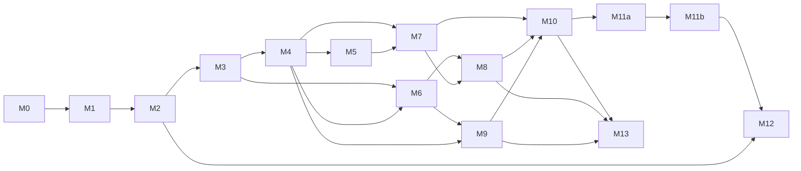

# Abstract Economic Simulation Framework
## Implementation Roadmap

**Version:** 1.0  
**Status:** Planning baseline (draft)  
**Companions:** 01–07

---

## 1. Purpose and Use

This roadmap orders the implementation of the framework (01–05) and the reference implementation (07) so that **risks are retired early and spread evenly**, and so that a working, tested, and, from M2, playable system exists at the end of every milestone.

It is the input for **OpenSpec change specs**:

- Each row in a milestone's change table is one OpenSpec change. Its **Change ID** is the OpenSpec change name.
- The **Capability** column is the OpenSpec spec path (`openspec/specs/<capability>/spec.md`), following the taxonomy in Section 6.
- **Sources** are requirement IDs (06 §3.1). They tell the proposal author which sections are normative for the change.
- **Depends on** lists changes that must be archived before this one is applied. Changes without a mutual dependency may run in parallel (Section 8).
- **Size:** S ≈ up to 1 day, M ≈ 1–3 days, L ≈ 3–5 days of implementation including tests. Anything larger must be split before proposing.

Section 7 is the drafting guide for turning a row into a change.

---

## 2. Strategy

1. **Walking skeleton first.** The full tick pipeline with all 33 phases, hashing, save/load, and the determinism harness exists before any game mechanic (M0). Every later change fills in phases of a structure that is already tested.
2. **Riskiest first.** Determinism in JavaScript, package boundaries, and phase semantics are the most expensive to fix late. They come first.
3. **Vertical slices along the minimal configurations.** The order follows 01 §23: basic loop (23.1) → logistics (23.2) → progression (23.3) → complete game (23.4/23.5). Each slice goes from content schema to kernel to projection to client.
4. **Playable early.** A thin browser client exists from M2 and grows with every milestone. Design risks (legibility, the planning currency, the fun of the loop) are tested by playing, not by reading specs.
5. **Boundaries from day one.** Purity, theme-freedom, and the framework/reference separation are enforced by tooling before the first line of simulation code (M0).
6. **Every milestone ends green and demonstrable.** Exit criteria are tests (scenarios from 06 §9.3) plus a demo.
7. **Spec reconciliation per milestone.** Each milestone ends with OpenSpec verification and an update of 01–07 for any clarified or amended behavior (05 §26).

---

## 3. Risk Register

| ID | Risk | Likelihood | Impact | Mitigation (where retired) |
| --- | --- | --- | --- | --- |
| R-01 | Determinism breaks in JavaScript (floating point, iteration order, engine differences) | High | High | M0: `fx`, canonical encoding, hashing, RNG, browser/Node matrix (0.3, 0.4, 0.9); continuous L7 |
| R-02 | Framework/reference boundary erodes; game terminology leaks into the framework | Medium | High | M0: dependency-cruiser, theme-free lint (0.2) |
| R-03 | Tick-phase semantics are ambiguous; phase interaction bugs surface late | High | High | M0 pipeline skeleton (0.6); M1 slice through phases 05–26; TDS-11.3 clarifications |
| R-04 | Core economic semantics (reservations, all-or-nothing, need windows) implemented wrongly | Medium | High | M1 with invariants INV-01…08, 15, 22 |
| R-05 | The content pipeline (03 is large) stalls progress | Medium | Medium | M1 schemas only for features in scope; each later change adds its own schemas |
| R-06 | TypeScript simulation too slow for browser play | Medium | High | Bench harness in M1 (1.16), browser host in M2, budgets per milestone, optimization in M12 |
| R-07 | Presentation contract unworkable in practice (projection size, deltas, worker messaging) | Medium | High | M2 thin client end to end |
| R-08 | The game is not legible or fun; design ideas do not emerge | Medium | High | Playable client from M2, planning view in M4, progression in M7, balance runner in M11 |
| R-09 | Spatial and placement complexity (grid, working areas, coverage, connectivity) | Medium | Medium | M3 dedicated milestone |
| R-10 | Save compatibility breaks repeatedly during development | High | Medium | Versioned save format in M2; golden policy (06 §9.4); migrations in M12 |
| R-11 | Fog leaks undiscovered information | Medium | Medium | M8 fog-filtered projections with property tests (INV-19, P-09) |
| R-12 | Exchanges become a money exploit | Low | Medium | M9 elasticity invariants; M10 arbitrage diagnostics |
| R-13 | Transport complexity (orders, quantity rules, failure policies) | High | Medium | M6 split into small changes |
| R-14 | Specification gaps found late cause rework | High | Medium | Amendment process (05 §26); spec reconciliation at every milestone |
| R-15 | Scope creep (modules, tooling, polish) | Medium | Medium | Optional modules last (M13); non-goals in 07 §17 |
| R-16 | Agent-driven implementation drifts from the specification | Medium | High | AGENTS.md, requirement IDs in specs and tests, trace gate (06 §3.3), `/opsx-verify` before archive |

---

## 4. Milestone Overview

| Milestone | Theme | Retires | Exit scenario(s) | Release |
| --- | --- | --- | --- | --- |
| M0 | Foundation and walking skeleton | R-01, R-02, R-03 (structure), R-16 | Empty world determinism matrix | v0.1 Skeleton |
| M1 | Basic economic loop (headless) | R-03, R-04, R-05, R-06 (baseline) | SCN-01 | — |
| M2 | Session, projections, thin browser client | R-07, R-06 (browser), R-08 (first look), R-10 (format) | SCN-13 basic, client smoke | v0.2 Loop |
| M3 | Space and construction | R-09 | Placement scenario, INV-20 | — |
| M4 | Continuous economy and planning metrics | R-08 (planning currency) | SCN-04, SCN-18 (framework) | v0.3 Builder |
| M5 | Internal-logistics throughput | — | SCN-10 | — |
| M6 | Inter-location logistics | R-13 | SCN-02 | v0.4 Archipelago |
| M7 | Progression | R-08 (pyramid, breadth/depth) | SCN-03, 07, 08, 09, 11, 12 | v0.5 Ascent |
| M8 | Regions, exploration, establishment | R-11 | SCN-05 | — |
| M9 | Exchanges | R-12 | SCN-06 | v0.6 Trade |
| M10 | Validation and diagnostics completeness | R-14 (content side) | Diagnostic fixture suite | — |
| M11a | Reference prototype game | R-08 (balance) | SCN-14, SCN-18 (reference) | v0.9 Prototype |
| M11b | Reference full game | — | SCN-14 on R4 content | — |
| M12 | Persistence hardening, tooling, performance | R-06 (final), R-10 | SCN-13 full, bench budgets | v1.0 |
| M13 | Optional modules | R-15 (contained) | SCN-15, 16, 17 | v1.1 |

### 4.1 Milestone dependencies



M5 and M6 may overlap. M8 and M9 may overlap. M12 changes that depend only on M2 (migrations, replay documents) may start early.

---

## 5. Milestones

### M0 — Foundation and Walking Skeleton

**Goal:** A monorepo with enforced boundaries and an empty but complete, deterministic, hashable, savable tick pipeline that produces the same hashes in Node and in the browser.

| # | Change ID | Capability | Scope | Sources | Depends on | Size |
| --- | --- | --- | --- | --- | --- | --- |
| 0.1 | `setup-workspace` | foundation/workspace | pnpm workspace; all package stubs of TDS-4.2; tsconfig project references; Vitest, ESLint, Prettier; CI skeleton ✓ archived 2026-10-21 | TDS-2, TDS-4.1, TDS-4.2, TDS-25, VER-15.3 | — | M |
| 0.2 | `add-purity-and-boundary-guardrails` | foundation/purity | dependency-cruiser rules; restricted globals, properties, and syntax; theme-free lint; ambient-API traps; registry deep-freeze helper ✓ archived 2026-10-21 | TDS-4.3, TDS-5 | 0.1 | S |
| 0.3 | `add-fixed-point-arithmetic` | foundation/fixed-point | `fx` module, rounding modes, `alloc-v1`, rate accumulators; properties P-01 to P-03 ✓ archived 2026-10-21 | TDS-6 | 0.2 | M |
| 0.4 | `add-deterministic-primitives` | foundation/determinism | canonical JSON, FNV-1a 64, xoshiro128\*\* streams, stable sort, string comparison, branded IDs, `Result`; properties P-04, P-05 ✓ archived 2026-10-21 | TDS-7, TDS-9.4, TDS-15, TDS-19.3, TDS-19.4, TDS-23 | 0.2 | M |
| 0.5 | `add-world-state-model` | kernel/world-state | `World` record, entity allocator, `ComponentStore` with sorted iteration and tombstones, owners table, encode/decode/clone/hash ✓ archived 2026-10-21 | TDS-8, ARCH-3, ARCH-4.2 | 0.3, 0.4 | M |
| 0.6 | `add-tick-pipeline-skeleton` | kernel/tick-pipeline | phase table 01–33 as registered no-ops, `SystemDescriptor`, `TickContext`, `EventWriter`, `step`, `runPhases`, write-set checks in test builds ✓ archived 2026-10-21 | TDS-10, TDS-11, ARCH-5 | 0.5 | M |
| 0.7 | `add-testkit-foundation` | testkit/harness | store-level world builder; `checkInvariants` framework with INV-10, 17, 18, 21, 24; double-run, clone-run, and save-continue harnesses ✓ archived 2026-10-21 | VER-5.2, VER-6, VER-8.1 | 0.6 | M |
| 0.8 | `add-traceability-tool` | testkit/traceability | `pnpm trace`, `exempt.yaml`, generated `docs/traceability.md` ✓ archived 2026-10-21 | VER-3 | 0.1 | S |
| 0.9 | `add-browser-determinism-check` | testkit/determinism-matrix | empty-world replay in Vitest browser mode (Chromium) compared with Node | VER-8.2 | 0.7 | S |

**Exit criteria:** an empty world steps 10,000 ticks with stable hashes; hashes are equal in Node and Chromium; a deliberately forbidden import or `Math.random` call fails CI; the trace report is generated.

---

### M1 — Basic Economic Loop (headless)

**Goal:** The closed loop of 01 §23.1 and the 03 §14 example runs headlessly from YAML content, with invariants after every tick and a golden hash.

| # | Change ID | Capability | Scope | Sources | Depends on | Size |
| --- | --- | --- | --- | --- | --- | --- |
| 1.1 | `add-content-package-loader` | content/package-loading | `PackageSource`, manifests, dependency versions, strict YAML parsing, diagnostics model | CONT-2, CONT-3, CONT-12, TDS-20.1, TDS-20.3 | 0.4 | M |
| 1.2 | `add-core-definition-schemas` | content/schemas | TypeBox schemas for resource (incl. capability), abstract location template, recipe, entity components (source, producer, residence, storage access), population tier, need (resource consumption and availability), need category, growth policy; ID rules; JSON Schema export | CONT-4, CONT-6.1, CONT-6.2, CONT-6.4, CONT-6.7–6.11, CONT-6.13, CONT-6.14, TDS-20.4 | 1.1 | L |
| 1.3 | `add-definition-composition` | content/composition | includes, merge operations, cycle detection; property P-11 | CONT-5 | 1.2 | S |
| 1.4 | `add-registry-compilation` | content/registry | reference resolution, handle assignment, indexes, normalization, checksum, frozen `Registry`; property P-12 | CONT-11.3, CONT-12, TDS-7, TDS-20.2 | 1.3, 0.5 | M |
| 1.5 | `add-testkit-content-builders` | testkit/harness | fluent `content()` builder through the real pipeline; query and assertion helpers | VER-5.2 | 1.4, 0.7 | S |
| 1.6 | `add-condition-and-curve-compiler` | content/conditions | expression tree, type checking, evaluator, curves, initial domain queries (without `sustained`) | CONT-7.1–7.3, CONT-8, TDS-14.1, TDS-14.2, TDS-14.4 | 1.4 | M |
| 1.7 | `add-inventory-transactions` | kernel/transactions | inventories, capacity rules, reservation ledger, purposes, transaction union, atomic builder, journal; INV-01 to 04, 15 | GDD-8.1–8.4, ARCH-6, ARCH-12, TDS-12 | 0.6 | L |
| 1.8 | `add-abstract-capacity-locations` | sim/spatial | `SpatialPolicy` interface, `abstract_capacity` policy, location entities, `shared_location` access policy, default world instantiation | GDD-6.1, ARCH-11, ARCH-12, CONT-6.4, CONT-6.6 | 1.4, 1.7 | M |
| 1.9 | `add-capability-allocation` | sim/capabilities | phases 05–06; recomputed pools; binary, proportional, priority, and weighted models; exact matching and substitutes; INV-05 | GDD-4.7, GDD-14, ARCH-13, TDS-6.3 | 1.8 | M |
| 1.10 | `add-production-processes` | sim/production | infinite and finite sources; producer state machine; batch and continuous modes; block reasons; phases 07, 11–13; INV-15, INV-22 | GDD-4.3, GDD-9.4, GDD-9.5, GDD-10.1–10.4, ARCH-5.2 | 1.9 | L |
| 1.11 | `add-residences-and-population-outputs` | sim/population | residences, population groups, capability outputs with accumulators (phase 26, outputs only) | GDD-11.1–11.3, TDS-6.4 | 1.9 | M |
| 1.12 | `add-needs-and-satisfaction` | sim/needs | demand (phase 08); delivery (phase 20) for resource consumption and availability; fulfillment windows; all category modes; satisfaction Z (phase 21); INV-08 | GDD-4.2, GDD-12.1–12.5 | 1.10, 1.11 | L |
| 1.13 | `add-population-growth` | sim/population | growth policies (phase 23), fraction accumulation; INV-07 | GDD-11.4, CONT-6.14 | 1.12, 1.6 | S |
| 1.14 | `add-scenario-runner-and-cli` | host/cli | scenario format and pure runner (`@aesfw/testkit/scenario`); `aesfw validate`, `aesfw run` | VER-9.1, VER-9.2, TDS-21.2 | 1.5 | M |
| 1.15 | `add-golden-basic-loop` | testkit/scenarios | `fixtures/content/demo-basic-loop` from CONT-14; SCN-01 with goldens | VER-9.3, GDD-23.1 | 1.13, 1.14 | S |
| 1.16 | `add-benchmark-harness` | testkit/bench | `bench.small`, `aesfw bench`, JSON results, nightly trend job | TDS-24, VER-14 | 1.14 | S |

**Exit criteria:** SCN-01 passes with invariants after every tick and identical hashes in the double-run and save-continue harnesses; `bench.small` baseline recorded.

---

### M2 — Session, Projections, and Thin Browser Client

**Goal:** The basic loop runs in a Web Worker and is observable and controllable in a minimal browser client that uses only the protocol. Saves work.

| # | Change ID | Capability | Scope | Sources | Depends on | Size |
| --- | --- | --- | --- | --- | --- | --- |
| 2.1 | `add-protocol-dtos` | app/protocol | DTO types and codecs v1: command envelope and result, snapshot, delta, event, definition metadata, entity detail, location summary, need breakdown, worker messages | PIC-3, PIC-4, PIC-9, PIC-11–13, TDS-22 | 0.2 | M |
| 2.2 | `add-session-and-command-gateway` | app/session | `SessionState`, create/submit/advance, revision semantics, phase 01 for `SetEntityEnabled`, `SelectRecipe`, `SetProcessPriority`, `SetCapabilityPriority`; `CommandApplied`/`CommandRejected`; error code registry | ARCH-7, TDS-16, TDS-18.1–18.3 | 1.15, 2.1 | M |
| 2.3 | `add-projections-and-deltas` | app/projections | per-actor projection, full snapshot, `diffProjection`, resync rules; property P-10 | ARCH-8, PIC-9, PIC-18, TDS-18.4 | 2.2 | M |
| 2.4 | `add-core-read-models` | app/projections | definition metadata, entity detail, location summary, need breakdown | PIC-4, PIC-10.1–10.3 | 2.3 | M |
| 2.5 | `add-save-load` | app/persistence | `SaveDocument`, save/load, content-mismatch diagnostics; SCN-13 (basic content) | ARCH-15.1–15.3, TDS-19.1, TDS-19.3 | 2.2 | M |
| 2.6 | `add-web-worker-host` | host/web | worker entry, `SessionClient`, message protocol, clock and speed, catch-up limit, coalescing, IndexedDB saves, error boundary | TDS-21.1 | 2.3, 2.5 | M |
| 2.7 | `add-reference-content-seed` | reference/content | R0 content and presentation package skeleton | REF-3–6 | 1.15 | S |
| 2.8 | `add-client-shell` | reference/client | Vite app, tokens, layout, signals, mirror, view state, i18n with fallback, top bar controls, debug overlay | REF-9–11, REF-12.5, REF-14 | 2.6, 2.7 | M |
| 2.9 | `add-client-inspector-and-tables` | reference/client | entity and residence inspector; inventory and population tables; table mode; enable and recipe commands | REF-12.3, REF-12.4, REF-15 | 2.8, 2.4 | M |
| 2.10 | `add-client-smoke-e2e` | reference/client | Playwright smoke flows 1, 2, 4, 6; browser hash equals CLI hash for the same command log | VER-13.2, VER-8.2 | 2.9 | S |

**Exit criteria:** the R0 loop runs in the browser; disabling a producer visibly lowers satisfaction; save → reload → continue works; browser and CLI hashes match. **Demo:** first playtest of the closed loop.

---

### M3 — Space and Construction

**Goal:** Players build on a grid with authoritative placement validation; connectivity and slot/area sources create the "space" currency.

| # | Change ID | Capability | Scope | Sources | Depends on | Size |
| --- | --- | --- | --- | --- | --- | --- |
| 3.1 | `add-grid-spatial-policy` | sim/spatial | grid policy, buildable mask (fixed or seeded), footprints, orientation, occupancy cache, distance and radius queries; INV-20 | GDD-6.1, ARCH-11, CONT-6.4, TDS-8.4 | 1.8 | L |
| 3.2 | `add-construction-lifecycle` | sim/construction | lifecycle states, plans, cost reservation, commit policies, cancellation, deconstruction policies (phases 03, 30) | GDD-9.1, GDD-18.1, GDD-18.3, CONT-6.8 | 3.1, 1.7 | L |
| 3.3 | `add-placement-predicates-and-commands` | sim/construction | generic predicates; `placement_query`; `PlaceEntityPlan`, `CancelEntityPlan`, `CommitConstruction`, `DeconstructEntity` | GDD-18.2, PIC-12.1, ARCH-7.3 | 3.2, 2.2 | M |
| 3.4 | `add-connectivity-requirement` | sim/spatial | connectivity provider and requirement, binary hub access, `missing_inventory_access`, phase 04 rebuild | GDD-10.2, GDD-9.9, ARCH-5.2 | 3.1 | M |
| 3.5 | `add-slot-and-area-sources` | sim/production | source slots, working-area claims, property-vector scaling, regenerating and condition-dependent sources | GDD-6.5, GDD-9.5, CONT-6.8 | 3.1, 1.10 | M |
| 3.6 | `add-reference-content-builder-stage` | reference/content | R1 part 1: grid location, BM1, extractors, refiner, connector | REF-5, REF-7 | 3.3, 3.4, 3.5 | S |
| 3.7 | `add-client-location-grid` | reference/client | SVG grid view, shape grammar, state encoding, connectivity and suitability overlays | REF-10, REF-12.2, REF-14.3 | 2.9, 3.6 | L |
| 3.8 | `add-client-placement-mode` | reference/client | build palette, ghost with authoritative preview, keyboard placement, construction commands | REF-13.1–13.3 | 3.7 | M |

**Exit criteria:** a placement scenario (valid, invalid, cancelled, deconstructed) passes; INV-20 holds; a player can build the R1 chain from scratch in the browser.

---

### M4 — Continuous Economy and Planning Metrics

**Goal:** The balance currency, maintenance while idle, the deficit loss spiral, and the planning currency (supported population) are in place.

| # | Change ID | Capability | Scope | Sources | Depends on | Size |
| --- | --- | --- | --- | --- | --- | --- |
| 4.1 | `add-balance-resources-and-income` | sim/economy | owner-scoped resources, `allow_negative`, population income with satisfaction curve (phase 26) | GDD-7.5, GDD-11.3, GDD-20.2, CONT-6.3 | 1.11 | M |
| 4.2 | `add-maintenance` | sim/economy | charge policies, intervals, shortage policies including delegation | GDD-4.8, GDD-20.1 | 4.1 | M |
| 4.3 | `add-owner-deficit-policy` | sim/economy | phase 27 pause/resume ordering, `paused_by_deficit`, `ResumeDeficitPausedEntities`; INV-11, INV-23 | GDD-3.7, GDD-20.3, CONT-6.22 | 4.2 | M |
| 4.4 | `add-owner-economy-read-model` | app/projections | revenue and expenses by source, idle-but-paying, paused entities | PIC-10.6 | 4.3, 2.4 | S |
| 4.5 | `add-planning-metrics-read-model` | app/projections | supported population, chain metrics, integer ratios; SCN-18 (framework fixture) | GDD-3.8, GDD-10.6, PIC-10.5, TDS-18.5 | 2.4, 1.13 | M |
| 4.6 | `add-golden-loss-spiral` | testkit/scenarios | SCN-04 | VER-9.3 | 4.3 | S |
| 4.7 | `add-client-economy-and-planning` | reference/client | balance in top bar; economy and planning views; R1 credits and maintenance content | REF-12.4 | 4.4, 4.5, 3.8 | M |

**Exit criteria:** SCN-04 and SCN-18 (framework) pass. **Demo:** a player sees why a chain loses money and how many inhabitants it supports.

---

### M5 — Internal-Logistics Throughput

| # | Change ID | Capability | Scope | Sources | Depends on | Size |
| --- | --- | --- | --- | --- | --- | --- |
| 5.1 | `add-throughput-allocation` | sim/internal-logistics | throughput pools, request collection (phase 09), `alloc-v1` (phase 10), throttling semantics for phases 11–20, `throughput_throttled`; INV-06 | GDD-6.6, GDD-15.1, ARCH-5.2, TDS-11.3 | 1.13, 3.4 | M |
| 5.2 | `add-storage-providers` | sim/internal-logistics | capacity and throughput expansion by storage entities | GDD-9.7 | 5.1 | S |
| 5.3 | `add-golden-throughput-throttling` | testkit/scenarios | SCN-10 | VER-9.3 | 5.1 | S |
| 5.4 | `add-client-throughput-indicators` | reference/client | throughput gauge, overlay, throttle display; R1 storage module | REF-12.2 | 5.2, 3.7 | S |

**Exit criteria:** SCN-10 passes; over-densification is visible in the client.

---

### M6 — Inter-Location Logistics

**Goal:** 01 §23.2. Isolated inventories connected by transport units executing routes.

| # | Change ID | Capability | Scope | Sources | Depends on | Size |
| --- | --- | --- | --- | --- | --- | --- |
| 6.1 | `add-world-definition-and-connections` | sim/world | world definition, multiple locations, connection instances, initial owners, location activation, `ActivateLocation`/`DeactivateLocation` | GDD-6.2, GDD-6.3, CONT-6.5, CONT-6.6 | 1.8 | M |
| 6.2 | `add-transport-units-and-cargo` | sim/transport | transport entities, cargo compartment policies, endpoints, maintenance; INV-16 | GDD-9.8, GDD-15.4, CONT-6.16 | 6.1, 4.2 | M |
| 6.3 | `add-route-planning-and-movement` | sim/transport | `shortest_stable` planner, traversal time, movement (phase 16), abstract transfer variant | ARCH-14.1–14.3 | 6.2 | M |
| 6.4 | `add-transport-orders-and-stations` | sim/transport | route mode, station cursor, load/unload, handling rates, failure policies, order templates (phases 14–16, 19); transport commands | GDD-15.2, GDD-15.5–15.7, ARCH-14.4, CONT-9 | 6.3, 2.2 | L |
| 6.5 | `add-transport-quantity-rules` | sim/transport | all quantity rules of GDD-15.3 | GDD-15.3 | 6.4 | M |
| 6.6 | `add-transport-read-model` | app/projections | transport detail and events | PIC-10.4 | 6.4, 2.4 | S |
| 6.7 | `add-golden-logistics-loop` | testkit/scenarios | SCN-02 | VER-9.3 | 6.5 | S |
| 6.8 | `add-client-world-map` | reference/client | world map, transport interpolation, R2 content | REF-12.1, REF-14.3 | 6.6, 3.7 | M |
| 6.9 | `add-client-route-editor` | reference/client | logistics view and route editor | REF-12.4 | 6.8 | M |

**Exit criteria:** SCN-02 passes; a route created in the browser supplies a second location.

---

### M7 — Progression

**Goal:** 01 §23.3. Tiers, transitions, bands, pyramid rule, breadth versus depth, coverage, purpose locks, and unlocks.

| # | Change ID | Capability | Scope | Sources | Depends on | Size |
| --- | --- | --- | --- | --- | --- | --- |
| 7.1 | `add-sustained-conditions` | content/conditions | `sustained` compilation, timers (phase 22), persistence | CONT-7.2, TDS-14.3 | 1.6, 2.5 | M |
| 7.2 | `add-satisfaction-bands` | sim/needs | band tables, effects, grace timers; INV-09 | GDD-12.6, CONT-6.19 | 7.1, 4.1 | M |
| 7.3 | `add-tier-transitions` | sim/transitions | generic transition engine; triggers; atomic costs with purpose; conversion and refund policies; empty-residence policies; advancement and decline; `RequestPopulationTransition` (phase 24) | GDD-9.3, GDD-13, CONT-6.15 | 7.2, 3.2 | L |
| 7.4 | `add-purpose-locks` | kernel/transactions | `SetResourcePurposeLock`, access filtering for all purposes including `transport_load` | GDD-8.5, GDD-15.3 | 1.7, 2.2 | S |
| 7.5 | `add-unlocks` | sim/unlocks | unlock definitions, scopes, definition and command availability, metadata exposure (phase 25) | GDD-19, CONT-6.17, PIC-4 | 7.1 | M |
| 7.6 | `add-services-and-coverage-needs` | sim/needs | coverage and capacity service providers; `spatial_coverage`, `service_capacity`, and `state_query` needs | GDD-3.6, GDD-9.6, GDD-12.2, CONT-6.11, CONT-6.12 | 3.1, 1.13 | M |
| 7.7 | `add-transition-eligibility-read-model` | app/projections | condition breakdown including sustained-timer progress | PIC-10.1 | 7.3, 2.4 | S |
| 7.8 | `add-progression-goldens` | testkit/scenarios | SCN-03, 07, 08, 09, 11, 12 | VER-9.3 | 7.3, 7.4, 7.5, 7.6 | M |
| 7.9 | `add-client-population-and-transitions` | reference/client | tier pyramid, residence checklist, transition command, purpose-lock toggles, coverage overlay; R3 partial content (S2) | REF-12.3, REF-12.4 | 7.7, 4.7 | M |

**Exit criteria:** all progression scenarios pass. **Demo:** the pyramid trade-off and breadth versus depth are playable.

---

### M8 — Regions, Exploration, and Establishment

| # | Change ID | Capability | Scope | Sources | Depends on | Size |
| --- | --- | --- | --- | --- | --- | --- |
| 8.1 | `add-regions-and-distribution-rules` | sim/world | regions; fixed and seeded property vectors and slots; disjoint distribution rules (generation and validation) | GDD-3.3, GDD-6.4, GDD-6.5, CONT-6.18 | 6.1, 3.5 | M |
| 8.2 | `add-knowledge-and-exploration` | sim/exploration | owner knowledge state, discovery on arrival (phase 18), explore mode; INV-14 | GDD-16.1, GDD-16.2, ARCH-14.4 | 6.4 | M |
| 8.3 | `add-location-establishment` | sim/exploration | establish mode, establishment transaction, hub creation, exclusive ownership | GDD-16.3, CONT-6.20 | 8.2 | M |
| 8.4 | `add-fog-filtered-projections` | app/projections | per-actor filtering of all projections, read models, and events; INV-19; P-09 | ARCH-8.3, PIC-9.3 | 8.2, 2.3 | M |
| 8.5 | `add-golden-exploration` | testkit/scenarios | SCN-05 | VER-9.3 | 8.3 | S |
| 8.6 | `add-client-fog-and-expansion` | reference/client | fog rendering, explore and establish flows | REF-12.1 | 8.4, 6.9 | M |

**Exit criteria:** SCN-05 and fog properties pass; no projection leaks unknown attributes.

---

### M9 — Exchanges

| # | Change ID | Capability | Scope | Sources | Depends on | Size |
| --- | --- | --- | --- | --- | --- | --- |
| 9.1 | `add-exchange-price-state` | sim/exchanges | exchange definitions, price state, elasticity, recovery (phase 28); INV-12 | GDD-3.11, GDD-17.1–17.3, ARCH-14.5, CONT-6.21 | 6.1, 4.1 | M |
| 9.2 | `add-trade-execution` | sim/exchanges | trade mode and route trade actions, atomic trade, deterministic ordering (phase 17); INV-13 | GDD-17.4 | 9.1, 6.5 | M |
| 9.3 | `add-exchange-quotes-read-model` | app/projections | exchange quotes | PIC-10.7 | 9.1, 2.4 | S |
| 9.4 | `add-golden-exchange` | testkit/scenarios | SCN-06 | VER-9.3 | 9.2 | S |
| 9.5 | `add-client-exchange-view` | reference/client | exchange view, trade order shortcut | REF-12.4 | 9.3, 6.9 | S |

**Exit criteria:** SCN-06 passes; repeated sales visibly lower prices, which then recover.

---

### M10 — Validation and Diagnostics Completeness

| # | Change ID | Capability | Scope | Sources | Depends on | Size |
| --- | --- | --- | --- | --- | --- | --- |
| 10.1 | `add-graph-validation` | content/validation | composition compatibility; production, population, spatial/logistics, exchange, and unlock graphs | CONT-11.4, CONT-11.5 | 9.1, 7.5, 8.1 | L |
| 10.2 | `add-economic-diagnostics` | content/validation | all economic diagnostics | CONT-11.6 | 10.1 | M |
| 10.3 | `add-design-intent-diagnostics` | content/validation | all design-intent diagnostics, strict promotion | CONT-11.7, GDD-3.2 | 10.1 | M |
| 10.4 | `add-determinism-validation` | content/validation | determinism checks on content and modules | CONT-11.8 | 1.6 | S |
| 10.5 | `add-presentation-package-validation` | content/validation | presentation package checks | PIC-19 | 2.7 | S |
| 10.6 | `add-validation-report-cli` | host/cli | text and JSON reports with localized diagnostic messages | CONT-15, TDS-21.2 | 10.2, 10.3 | S |

**Exit criteria:** every diagnostic code has an invalid fixture (06 §10.2); the trace gate switches from warning to error (06 §3.3).

---

### M11a — Reference Prototype Game

| # | Change ID | Capability | Scope | Sources | Depends on | Size |
| --- | --- | --- | --- | --- | --- | --- |
| 11.1 | `add-reference-content-prototype` | reference/content | R3 content per Appendix B.0, including regions, fog, exchanges, and unlocks | REF-5, REF-7, GDD-23.5 | 10.3, 5.4, 7.9, 8.6, 9.5 | L |
| 11.2 | `add-balance-runner-strategies` | reference/content | scripted strategies, metrics CSV, balancing-target checks | REF-8 | 11.1 | M |
| 11.3 | `add-golden-complete-game` | reference/content | SCN-14 and the reference half of SCN-18 | VER-9.3 | 11.2 | S |
| 11.4 | `add-client-polish-and-accessibility` | reference/client | complete keyboard map, command palette, table-mode completeness, axe checks, reduced motion, dark theme | REF-13, REF-15 | 11.1 | M |

**Exit criteria:** strict validation with clean design-intent diagnostics; SCN-14 passes; balancing targets met or documented as deviations. **Demo:** first complete playtest of the prototype.

### M11b — Reference Full Game

| # | Change ID | Capability | Scope | Sources | Depends on | Size |
| --- | --- | --- | --- | --- | --- | --- |
| 11.5 | `add-reference-content-full` | reference/content | R4 content (all of Appendix B) | REF-5, REF-7 | 11.3 | L |
| 11.6 | `add-client-performance-pass` | reference/client | client budgets of REF-14.6 on R4 content | REF-14.6 | 11.5, 11.4 | M |

---

### M12 — Persistence Hardening, Tooling, and Performance

| # | Change ID | Capability | Scope | Sources | Depends on | Size |
| --- | --- | --- | --- | --- | --- | --- |
| 12.1 | `add-save-migrations` | app/persistence | versioning, ID aliases, data transforms, migration fixtures | ARCH-15.4, CONT-13, VER-8.3 | 2.5 | M |
| 12.2 | `add-replay-documents` | app/persistence | replay document, `aesfw replay`, browser export, divergence report | ARCH-16.2, TDS-19.2 | 2.5 | M |
| 12.3 | `add-debug-tooling` | app/debug | ledger, capability, and compiled-condition inspection; journal export; hash comparison; step N | ARCH-19, ARCH-20 | 12.2 | M |
| 12.4 | `add-productivity-modifiers` | sim/production | modifier sources, receivers, fixed stack order | GDD-10.5 | 1.10 | M |
| 12.5 | `add-alternative-inventory-access-policies` | sim/internal-logistics | `connected_graph` and `explicit_logistics` policies (phases 14–15) | GDD-15.1, ARCH-12 | 5.1 | M |
| 12.6 | `add-performance-optimizations` | kernel/performance | structure-of-arrays hot stores, incremental windows, closure fast path (P-13); `bench.large` budget | TDS-24, ARCH-18 | 11.5 | L |
| 12.7 | `add-full-determinism-matrix` | testkit/determinism-matrix | all engines in CI; SCN-13 on R4 content | VER-8.2 | 11.5 | S |

**Exit criteria:** all framework benchmark budgets met; SCN-13 passes on R4; benchmark regressions and mutation scores become blocking. **Release v1.0.**

---

### M13 — Optional Modules

| # | Change ID | Capability | Scope | Sources | Depends on | Size |
| --- | --- | --- | --- | --- | --- | --- |
| 13.1 | `add-module-framework` | sim/modules | `simulation_module` packages, phase 02/29 hooks, isolation validation | GDD-21, CONT-6.23, ARCH-5.2 | 10.4 | S |
| 13.2 | `add-scenario-objectives` | sim/modules | objectives, result events; SCN-17 | GDD-21 | 13.1, 7.1 | M |
| 13.3 | `add-disruptions` | sim/modules | seeded disruption stream; SCN-16 | GDD-21, TDS-15 | 13.1 | M |
| 13.4 | `add-multiple-owners` | sim/modules | other owners: exclusive establishment, shared elasticity, multi-actor sessions and subscriptions; SCN-15 | GDD-21, GDD-17.4 | 13.1, 8.3, 9.2 | M |
| 13.5 | `add-reference-modules-package` | reference/content | `ref.tier.modules`, scenario result banner, test owner switcher | REF-7, REF-17 | 13.2, 13.3, 13.4 | S |

**Exit criteria:** SCN-15, 16, and 17 pass; the core still passes every scenario with all modules disabled.

---

## 6. Capability Taxonomy (`openspec/specs`)

OpenSpec specs hold the **implemented, testable requirements**, with scenarios. Documents 01–07 remain the normative design source, and specs cite them by requirement ID. Capability paths:

```text
foundation/workspace          foundation/purity            foundation/fixed-point
foundation/determinism
kernel/world-state            kernel/tick-pipeline         kernel/transactions
kernel/performance
content/package-loading       content/schemas              content/composition
content/registry              content/conditions           content/validation
sim/spatial                   sim/construction             sim/production
sim/capabilities              sim/population               sim/needs
sim/transitions               sim/unlocks                  sim/economy
sim/internal-logistics        sim/world                    sim/transport
sim/exploration               sim/exchanges                sim/modules
app/protocol                  app/session                  app/projections
app/persistence               app/debug
host/web                      host/cli
testkit/harness               testkit/scenarios            testkit/traceability
testkit/determinism-matrix    testkit/bench
reference/content             reference/client
```

A capability spec grows over several changes. For example, `sim/needs` is created by 1.12 and extended by 7.2 and 7.6.

---

## 7. Drafting Guide for OpenSpec Changes

### 7.1 Starting a change

Use `/opsx-propose` (or `/opsx-new` followed by `/opsx-continue`) with the row's data:

```text
Change: add-production-processes            (Roadmap 08, M1 item 1.10)
Capability: sim/production
Sources: GDD-4.3, GDD-9.4, GDD-9.5, GDD-10.1–10.4, ARCH-5.2 (phases 07, 11–13), TDS-11, TDS-12
Depends on: add-capability-allocation (archived)
Must establish: INV-15, INV-22; L1 tests per VER-5.3
Out of scope: slot/area sources (3.5), throughput throttling (5.1), modifiers (12.4)
```

### 7.2 Artifact rules

| Artifact | Content |
| --- | --- |
| `proposal.md` | **Why:** the roadmap item and the risks it retires. **What:** the behavior delivered. **Out of scope:** explicitly the later roadmap items that touch the same area. **Impact:** packages and phases touched. |
| `specs/<capability>/spec.md` | Requirements phrased with SHALL. Each requirement cites its sources (`Source: GDD-10.2, ARCH-5.2`). Each scenario (WHEN/THEN) corresponds to exactly one test, whose title carries the same IDs (06 §3.2). |
| `design.md` | Only decisions not already fixed by 05. Reference 05 sections instead of repeating them. Record any amendment to 01–07 and any golden-hash change (06 §9.4). |
| `tasks.md` | Implementation, tests (unit, invariants, scenarios), trace tags, documentation updates, and golden updates as separate, checkable tasks. The last task is always "run `pnpm verify` and `pnpm trace`". |

### 7.3 Rules

- One roadmap row equals one change. If a row turns out to be too large, split it into `<id>-part-1`/`-part-2` and update this roadmap in the same change.
- A change never implements behavior belonging to a later row. If it needs a stub, the stub is a registered no-op or a typed "not supported" diagnostic.
- Each change adds or extends the theme-free framework fixtures it needs. Reference content changes are separate rows.
- Before archiving: run `/opsx-verify`, then sync specs (`/opsx-sync`) and archive (`/opsx-archive`).
- New risks, amendments, or reordered dependencies are recorded in this roadmap by the change that discovers them.

---

## 8. Parallelization Lanes

| Lane | Packages | Typical parallel work |
| --- | --- | --- |
| K — Kernel | core | M1: 1.7 ∥ content lane; M6: 6.2–6.5 ∥ R lane on M5 client items |
| C — Content | content | M1: 1.1–1.6 ∥ 1.7; M10 items in parallel after 10.1 |
| A — Application and hosts | app, protocol, host-* | M2: 2.1 can start during M1; 12.1 and 12.2 can start after M2 |
| R — Reference | reference/* | Client changes trail their read models by one change and run in parallel with the next kernel change |

Within a milestone, any two changes with no path between them in the **Depends on** column may be applied concurrently. Changes that touch the same system module should still be sequenced to avoid merge conflicts.

---

## 9. Cross-Cutting Work Per Milestone

At the end of every milestone:

1. **Spec reconciliation:** `/opsx-verify` on all milestone changes; update 01–07 for clarifications and amendments (05 §26).
2. **Benchmarks:** compare against budgets (05 §24, 07 §14.6) and record findings as risks or M12 items.
3. **Traceability:** `pnpm trace` shows the milestone's source sections as traced.
4. **Playtest note** (from M2): a short session-log entry about legibility and the design ideas observed, as input for reference content and client priorities.
5. **Roadmap update:** adjust sizes, dependencies, and risks for the next milestone.

---

## 10. Acceptance Criteria

- Every row has a unique change ID, a capability from Section 6, sources, dependencies, and a size.
- The dependency graph is acyclic, and every dependency points to an earlier or same-milestone change.
- Every scenario in 06 §9.3 is produced by a row in the milestone 06 lists. SCN-13 and SCN-18 are produced in two stages (2.5 and 12.7; 4.5 and 11.3).
- Every acceptance criterion of 01–04 (06 §16) is covered by the exit criteria of some milestone.
- Each milestone retires at least one risk or delivers a demonstrable playable increment.
